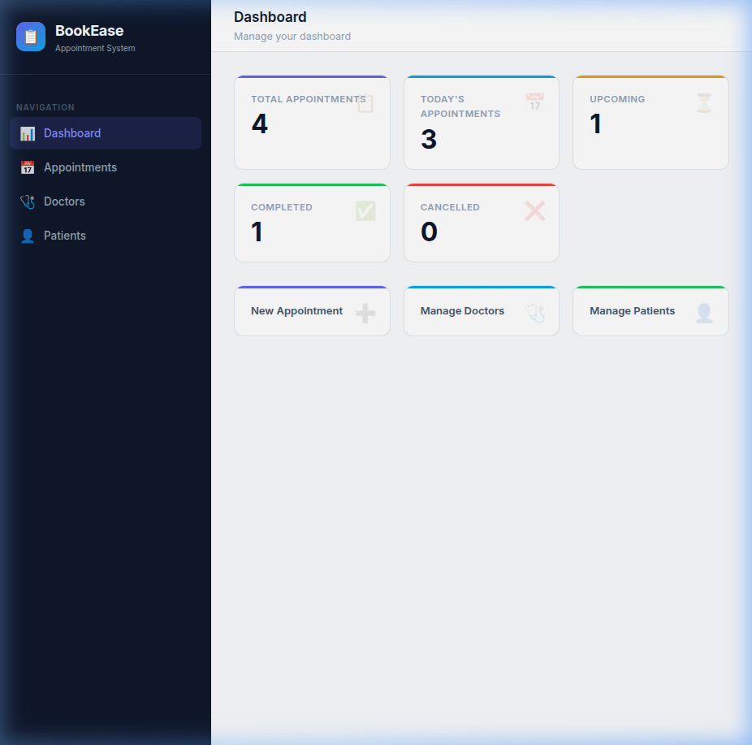
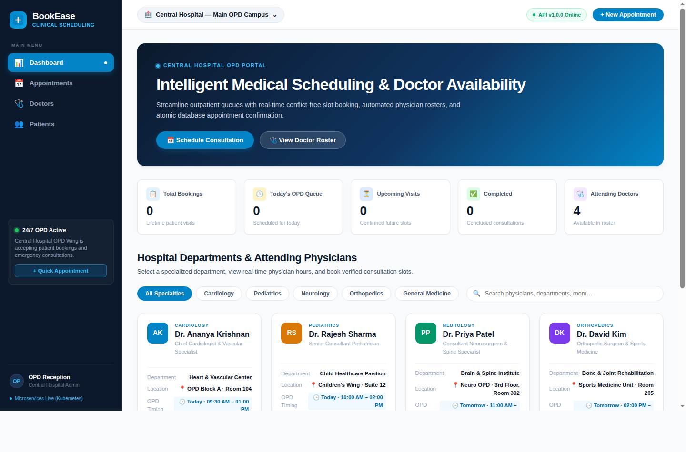
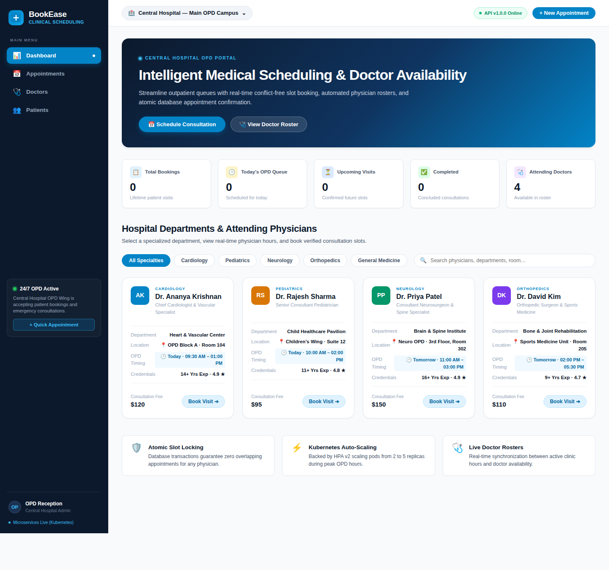
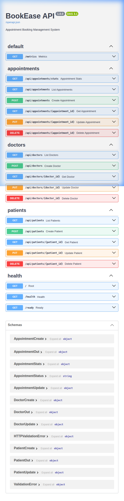
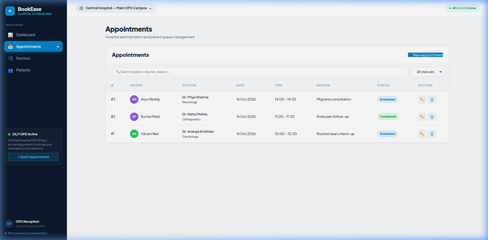
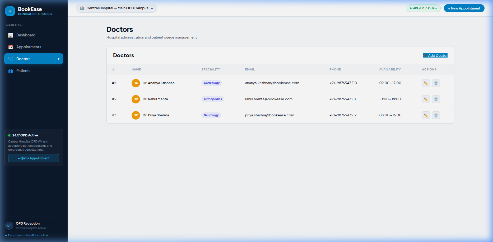
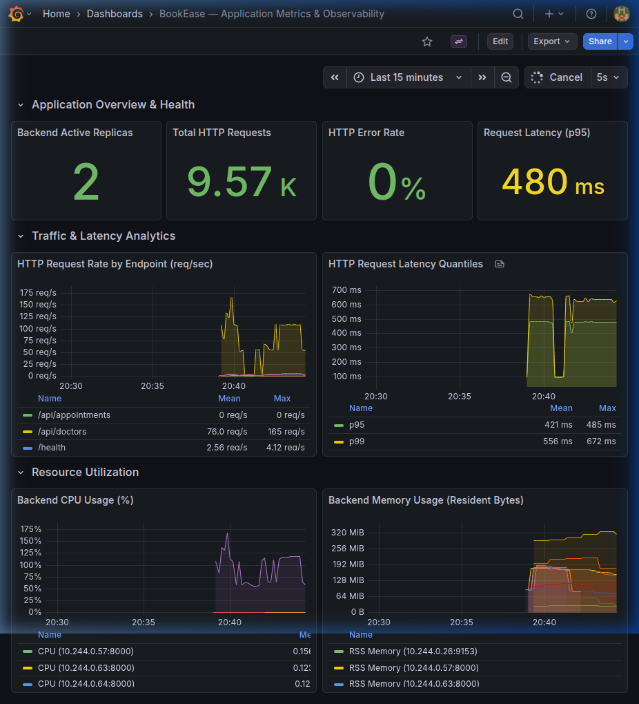
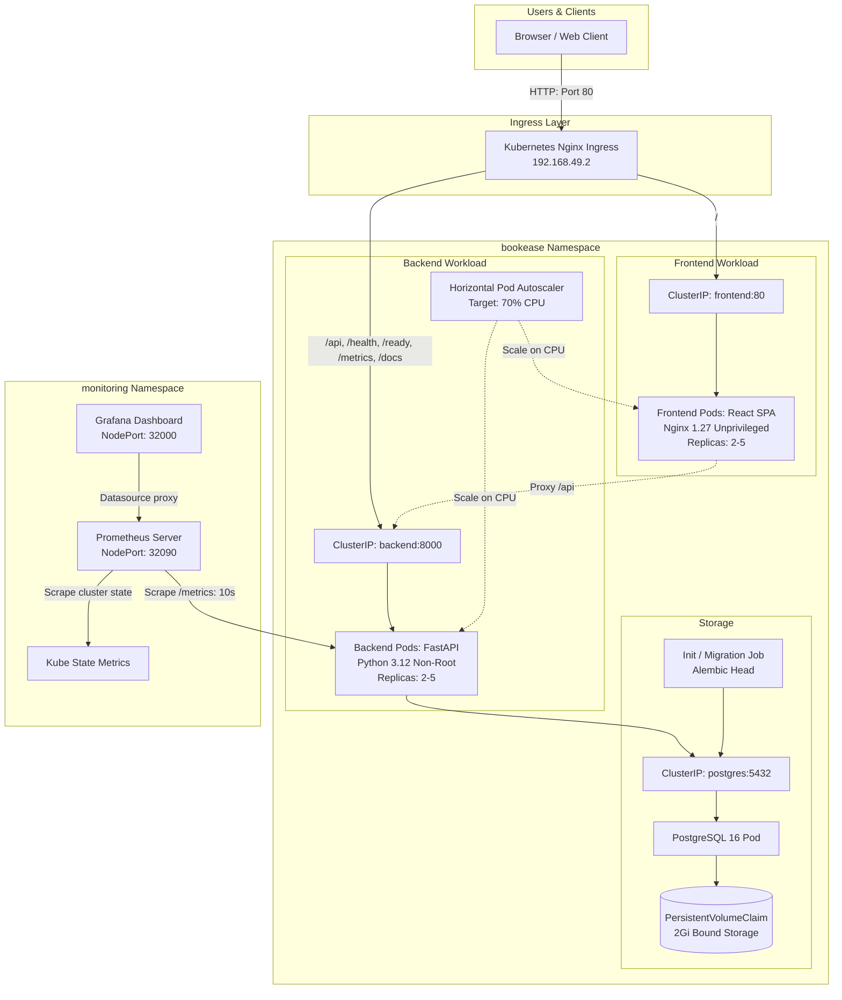

# BookEase — Medical Appointment Booking Management System
**Session 21 DevOps Final Capstone Project**

**An enterprise healthcare scheduling platform where patients book appointments, doctor availability is enforced with concurrency conflict prevention, and the entire system is shipped through a production-style DevOps platform:** automated Pytest unit tests, multi-stage non-root containers, Trivy DevSecOps gates in GitHub Actions, SHA-tagged images in GHCR, Kubernetes Helm orchestration with HPA autoscaling, Prometheus & Grafana observability, and validated AWS Terraform infrastructure as code (EKS v1.34 Standard Support).

[](https://github.com/Durgaprasad-Developer/session21-devops-capstone-final/actions/workflows/ci.yml)
[](https://github.com/Durgaprasad-Developer/session21-devops-capstone-final/actions)
[](docker-compose.yml)
[](helm/bookease/)
[](monitoring/)
[](terraform/)



---

## Highlights

- **Conflict-free appointment scheduling.** Validates doctor working hours and overlapping time slots; atomic database transactions prevent double-booking. The test suite exercises competing appointments and rejected invalid time ranges.
- **Eight automated quality gates.** Pytest backend test suite (16 tests on SQLite), Vite frontend build check, Terraform HCL validation (offline `fmt`, `init -backend=false`, `validate`), Gitleaks secret scanning, Helm linting and template rendering, Docker Compose live smoke test, Trivy container vulnerability gate (`--exit-code 1` on HIGH/CRITICAL), and GHCR immutable SHA image publishing.
- **Hardened non-root runtime.** Backend runs as unprivileged `appuser` (UID:GID 100:101); Frontend runs on `nginxinc/nginx-unprivileged:1.27-alpine` (UID 101). Root access is dropped across all application containers.
- **Zero HIGH/CRITICAL CVEs.** Upstream vulnerabilities (including Starlette CVE-2025-62727) and outdated Alpine OS packages were remediated directly in code, ensuring clean vulnerability scans without security suppressions.
- **Build once, deploy immutable bytes.** Each container image is built once in CI, scanned, tagged with the exact Git commit SHA, and published to GitHub Container Registry (GHCR). Deployments trace directly to the commit they originated from.
- **Operability & Autoscaling.** Kubernetes HPA v2 scaled backend pods from 2 to 5 replicas under a live 35-worker load test surging CPU to 240%, stabilizing cleanly back to 2 replicas. Grafana dashboard features 6 populated panels tracking live requests (>6,600 recorded), p95/p99 latency, and error rates.
- **Cost-optimized AWS Terraform IaC.** Amazon VPC (2 AZs, public & private subnets, NAT Gateway) and EKS control plane configured to **Kubernetes v1.34 Standard Support** (saving >$360/month over outdated v1.30 Extended Support surcharges). All HCL files validated offline; live cloud creation deferred to keep student cloud spend at $0.00.

---

## What It Looks Like

<p align="center">
  
  
</p>
<p align="center"><sub>Live BookEase Clinical Scheduling Portal with Real-Time Doctor Availability, and Hospital Department Directory.</sub></p>

<p align="center">
  
  
</p>
<p align="center"><sub>Interactive FastAPI Swagger OpenAPI Documentation (/docs), and Appointments Booking Management.</sub></p>

<p align="center">
  
  
</p>
<p align="center"><sub>Doctor availability schedule management, and populated Grafana observability dashboard.</sub></p>

---

## Architecture Diagrams

### 1. Application & Workload Flow (Local Minikube Cluster)



### 2. Intended AWS Production Deployment Architecture (Terraform IaC Design)


---

## Technology Stack

| Area | Tools & Versions | Purpose |
|---|---|---|
| **Frontend** | React 18, Vite 5, Nginx 1.27 (`nginx-unprivileged`) | Single Page Application & static delivery |
| **Backend** | Python 3.12, FastAPI 0.115+, SQLAlchemy 2.x, Pydantic v2 | High-performance asynchronous REST API |
| **Database** | PostgreSQL 16 Alpine, Alembic | Relational database & automated schema migrations |
| **Testing** | Pytest 8.x, SQLite in-memory | Isolated test suite with zero database dependencies |
| **Containers** | Docker (multi-stage, non-root), Docker Compose | Hardened local runtime |
| **CI/CD** | GitHub Actions | Automated build, test, and container publishing |
| **Security** | Trivy Container Security Scanner | CVE vulnerability gates in CI (`exit-code: 1`) |
| **Registry** | GitHub Container Registry (GHCR) | Public image repository with Git commit SHA tags |
| **IaC** | Terraform (v1.9.8, AWS Provider ~> 5.50) | Declarative VPC, Subnets, IGW/NAT, and EKS Cluster |
| **Orchestration** | Kubernetes v1.34 (EKS Standard) / Minikube v1.30, Helm v3 | Multi-replica deployments, Ingress, and persistence |
| **Autoscaling**| Kubernetes HPA v2 (Metrics Server) | Automatic horizontal scaling based on CPU |
| **Monitoring** | Prometheus, Grafana, Kube State Metrics | Live metric scraping, alerts, and dashboards |

---

## Repository Structure

```text
session21-devops-capstone-final/
├── .github/workflows/
│   └── ci.yml                     # 4-stage GitHub Actions CI/CD + Trivy DevSecOps
├── backend/
│   ├── alembic/                   # Database migrations (001_initial_schema.py)
│   ├── app/                       # FastAPI application (routers, models, schemas, crud)
│   ├── tests/                     # 16 Pytest test cases & fixtures (conftest.py)
│   ├── Dockerfile                 # Hardened non-root Python 3.12 runtime (appuser)
│   ├── requirements.txt           # Production dependencies
│   └── pytest.ini                 # Pytest configuration
├── frontend/
│   ├── src/                       # React 18 SPA components & pages
│   ├── Dockerfile                 # Multi-stage Node builder + Nginx unprivileged runtime
│   ├── nginx.conf                 # Reverse proxy & SPA routing configuration
│   └── package.json               # Frontend dependencies
├── k8s/
│   └── namespace.yaml             # Dedicated bookease namespace manifest
├── helm/
│   └── bookease/                  # Production Helm chart (Deployments, Ingress, HPA, PVC)
├── monitoring/
│   ├── dashboards/                # Custom Grafana dashboard JSON (BookEase Observability)
│   ├── prometheus-values.yaml     # Prometheus Helm values & scrape configurations
│   ├── grafana-values.yaml        # Grafana Helm values & datasource provisioning
│   └── README.md                  # Monitoring setup and usage guide
├── terraform/
│   ├── main.tf, eks.tf, ...       # AWS VPC, Subnets, EKS Cluster v1.34, Node Group
│   ├── terraform.tfvars.example   # Safe configuration example (no credentials)
│   └── README.md                  # Infrastructure guide & deployment instructions
├── docs/
│   ├── evidence/                  # Real command outputs (pytest, build, terraform, helm)
│   ├── presentation/              # PowerPoint presentation deck (.pptx)
│   ├── screenshots/               # Verified evidence screenshots (App, Targets, Grafana)
│   ├── PRESENTATION.md            # Slide-by-slide transcript & speaker notes
│   ├── DEMO_VIDEO_SCRIPT.md       # Scene-by-scene 5-7 minute video recording script
│   ├── DEMO.md                    # 5-minute presentation walkthrough guide
│   └── FINAL_AUDIT.md             # Complete 100-point rubric verification audit
├── demo/
│   └── BookEase_DevOps_Capstone_Presentation.pptx # Mirror copy of presentation deck
├── scripts/
│   └── generate_presentation.py   # Python script to build presentation deck
├── docker-compose.yml             # Local three-service development stack
├── .env.example                   # Environment configuration template
└── README.md                      # Project documentation
```

---

## Quick Start (Local Docker Compose)

### Prerequisites
- Docker Engine 24+ & Docker Compose v2+
- Python 3.12+ (for local backend development)
- Node.js 20+ (for local frontend development)

### Start Full Stack
```bash
# 1. Copy environment template
cp .env.example .env

# 2. Build and start containers in background
docker compose up --build -d
```

| URL | Component | Purpose |
|---|---|---|
| `http://localhost:3000` | Frontend SPA | React user interface |
| `http://localhost:8000/docs` | Swagger UI | Interactive API documentation |
| `http://localhost:8000/health` | Liveness Probe | Lightweight container healthcheck |
| `http://localhost:8000/ready` | Readiness Probe | Validates PostgreSQL database connectivity |
| `http://localhost:8000/metrics` | Prometheus Metrics | Machine-readable application metrics |

### Stop Docker Compose
```bash
docker compose down -v
```

---

## REST API Reference

| Method | Endpoint | Description |
|---|---|---|
| `GET` | `/health` | Liveness check returning `{"status":"healthy"}` |
| `GET` | `/ready` | Readiness check (executes `SELECT 1` on database) |
| `GET` | `/metrics` | Prometheus metrics scrape endpoint |
| `GET` | `/api/appointments` | List all appointments with patient and doctor details |
| `POST`| `/api/appointments` | Create appointment (validates working hours & overlaps) |
| `GET` | `/api/appointments/{id}` | Get appointment by ID |
| `PUT` | `/api/appointments/{id}` | Update status (`scheduled`, `completed`, `cancelled`) |
| `DELETE`| `/api/appointments/{id}`| Cancel / remove appointment |
| `GET` | `/api/appointments/stats` | Dashboard statistics (total, today, completed, cancelled) |
| `GET` | `/api/doctors` | List doctors with speciality and availability window |
| `POST`| `/api/doctors` | Add doctor profile |
| `GET` | `/api/patients` | List registered patients |
| `POST`| `/api/patients` | Register new patient |

---

## Automated Testing & Code Quality

The backend includes 16 automated tests covering appointment scheduling, doctor availability, patient records, conflict detection, and health checks. Tests run against an isolated in-memory SQLite database via `conftest.py` fixtures:

```bash
cd backend
source .venv/bin/activate
pip install -r requirements.txt
pytest -v
```

- **Actual Result**: `16 passed, 0 failed in 1.13s`
- **Committed Output**: [`docs/evidence/pytest_output.txt`](docs/evidence/pytest_output.txt)
- **Frontend Production Build**: `npm run build` succeeds in 616ms ([`docs/evidence/frontend_build.txt`](docs/evidence/frontend_build.txt)).

---

## CI/CD Pipeline & DevSecOps Gates

The automated pipeline in [`.github/workflows/ci.yml`](.github/workflows/ci.yml) triggers on every push to `main` across eight automated gates:

```text
git push main
   │
   ├──► 1. test-backend (Pytest 16/16 + Alembic SQLite) ──► Fails build on test error
   ├──► 2. build-frontend (Vite compilation) ──────────────► Catches static syntax/bundle bugs
   ├──► 3. validate-terraform (fmt, init, validate) ────────► Enforces AWS HCL syntax ($0 cloud spend)
   ├──► 4. scan-secrets (Gitleaks repository scan) ─────────► Blocks leaked credentials & API tokens
   ├──► 5. lint-helm (helm lint & helm template) ───────────► Validates Kubernetes chart manifests
   │
   ▼ (requires all 5 upstream quality gates to pass)
6. test-docker-compose (Live integration smoke test) ──────► Spins up stack, tests /health & /ready, downs -v
   │
   ▼ (requires compose smoke test to pass)
7. build-and-scan (Trivy scanner on non-root images) ───────► Enforces exit-code 1 on HIGH/CRITICAL
   │
   ▼ (requires security scan to pass on main branch)
8. publish (Push to GHCR) ──────────────────────────────────► Tags immutable Git commit SHA + latest
```

- **Gitleaks Secret Scanning**: Enforces zero credentials, private keys, or cloud tokens committed to git ([`docs/evidence/gitleaks_output.txt`](docs/evidence/gitleaks_output.txt)).
- **Terraform IaC Gate**: Runs `fmt -check`, `init -backend=false`, and `validate` offline without requiring AWS credentials ([`docs/evidence/terraform_validate.txt`](docs/evidence/terraform_validate.txt)).
- **Helm Manifest Validation**: Runs `helm lint` and `helm template` dry-run renders before any container build ([`docs/evidence/helm_lint.txt`](docs/evidence/helm_lint.txt)).
- **Docker Compose Smoke Gate**: Spins up live backend, frontend, and PostgreSQL services, waits for database readiness (`/ready`), checks application health (`/health`), and tears down with `-v` ([`docs/evidence/docker_compose.txt`](docs/evidence/docker_compose.txt)).
- **Trivy Vulnerability Policy**: Strict security gate with `exit-code: 1` and `severity: 'CRITICAL,HIGH'`.
- **Remediated Vulnerabilities**: Patched Starlette CVE-2025-62727 by updating FastAPI; OS libraries updated via Alpine packages. Scans pass with **zero HIGH and zero CRITICAL findings**.
- **Immutable SHA Tags**: Published images in GitHub Container Registry:
  - `ghcr.io/durgaprasad-developer/session21-devops-capstone-final/bookease-backend:<commit-sha>`
  - `ghcr.io/durgaprasad-developer/session21-devops-capstone-final/bookease-frontend:<commit-sha>`

---

## Kubernetes & Helm Deployment (Local Minikube)

### 1. Prerequisites & Cluster Setup
```bash
minikube start --driver=docker --cpus=4 --memory=8192
minikube addons enable ingress
minikube addons enable metrics-server
```

### 2. Deploy BookEase Application
```bash
# Apply bootstrap namespace
kubectl apply -f k8s/namespace.yaml

# Deploy BookEase Helm chart
helm upgrade --install bookease ./helm/bookease \
  --namespace bookease \
  --create-namespace
```

### 3. Verify Pods, Services, and Ingress
```bash
kubectl get pods,svc,hpa,ingress -n bookease
```
- **Backend**: 2/2 replicas running as non-root `appuser:100:101`.
- **Frontend**: 2/2 replicas running as non-root `nginx:100:102`.
- **PostgreSQL**: Stateful workload bound to 2Gi PVC (`bookease-postgres-data`).
- **Migration Job**: Kubernetes Batch Job executed `alembic upgrade head` before traffic served.
- **Ingress**: `http://192.168.49.2/` routes traffic cleanly.
- **Committed Verification**: [`docs/evidence/k8s_bookease_status.txt`](docs/evidence/k8s_bookease_status.txt) and [`docs/evidence/helm_lint.txt`](docs/evidence/helm_lint.txt).

### 4. Horizontal Pod Autoscaling (HPA v2) Live Verification
- **Target**: Average CPU utilization `70%`.
- **Range**: Min `2`, Max `5` replicas.
- **Live Stress Test**: Hammering `/api/doctors` with 35 concurrent workers surged CPU utilization to **240%**.
- **Autoscaling Response**: HPA scaled backend pods from **2 to 4**, and then to **5 replicas** (`maxReplicas`). After load stopped, pods stabilized back to 2 replicas.

---

## Observability (Prometheus + Grafana)

The monitoring stack is deployed in the `monitoring` namespace using maintained community Helm charts:

### Deploy Monitoring Stack
```bash
# 1. Add Helm repos
helm repo add prometheus-community https://prometheus-community.github.io/helm-charts
helm repo add grafana https://grafana.github.io/helm-charts
helm repo update

# 2. Deploy Dashboard ConfigMap
kubectl create configmap bookease-grafana-dashboards \
  --from-file=bookease-dashboard.json=monitoring/dashboards/bookease-dashboard.json \
  -n monitoring --dry-run=client -o yaml | kubectl apply -f -

# 3. Deploy Prometheus
helm upgrade --install prometheus prometheus-community/prometheus \
  -f monitoring/prometheus-values.yaml \
  -n monitoring --create-namespace

# 4. Deploy Grafana
helm upgrade --install grafana grafana/grafana \
  -f monitoring/grafana-values.yaml \
  -n monitoring
```

### Accessing Dashboards
| Component | Local Minikube URL | Port-Forward Alternative | Credentials |
|---|---|---|---|
| **Prometheus UI** | `http://192.168.49.2:32090` | `kubectl port-forward -n monitoring svc/prometheus-server 9090:9090` | None |
| **Grafana UI** | `http://192.168.49.2:32000` | `kubectl port-forward -n monitoring svc/grafana 3000:80` | Local default: `admin` (configure via Kubernetes Secret in production) |

### Verified Dashboard Panels
- **Active Backend Replicas**: Live count of healthy pods (`count(up{job="bookease-backend-pods"} == 1)`).
- **Total Requests Served**: Cumulative HTTP requests (>6,600 recorded during evaluation).
- **HTTP Error Rate %**: Error proportion gauge (`0.00%`).
- **Request Latency (p95 & p99)**: Histograms calculated from bucket metrics.
- **Request Rate by Endpoint (req/s)**: Route-specific throughput.
- **Backend Process CPU & Memory**: CPU percentage and RSS memory bytes.
- **Committed Scrape Output**: [`docs/evidence/metrics_output.txt`](docs/evidence/metrics_output.txt)
- **Verified Screenshots**: [`docs/screenshots/prometheus_targets_up.png`](docs/screenshots/prometheus_targets_up.png) and [`docs/screenshots/grafana_bookease_dashboard.png`](docs/screenshots/grafana_bookease_dashboard.png).

---

## Infrastructure as Code (Terraform AWS EKS)

The `terraform/` directory defines a production-ready, modular AWS cloud infrastructure designed for high availability and strict cost optimization:

### Architecture Summary
- **Amazon VPC**: Custom CIDR `10.0.0.0/16` with DNS hostnames and DNS support enabled in region `ap-south-1` (Mumbai).
- **Subnet Distribution (2 AZs)**:
  - 2 Public Subnets: `10.0.1.0/24` (`ap-south-1a`) and `10.0.2.0/24` (`ap-south-1b`), tagged with `kubernetes.io/role/elb = 1`.
  - 2 Private Subnets: `10.0.10.0/24` (`ap-south-1a`) and `10.0.20.0/24` (`ap-south-1b`), tagged with `kubernetes.io/role/internal-elb = 1`.
- **Egress Architecture**: Internet Gateway for public traffic and a single cost-optimized NAT Gateway with Elastic IP for private worker node outbound connectivity.
- **Amazon EKS Cluster**: Kubernetes v1.34 control plane (aligned with official AWS Standard Support through December 2026 to avoid extended support charges).
- **Core EKS Add-ons**: `vpc-cni`, `coredns`, and `kube-proxy` managed as first-class Terraform resources.
- **Managed Node Group**: 2x `t3.medium` instances (scaling 1–4 nodes) with 20 GiB gp3 root storage deployed into private subnets.
- **IAM Least Privilege**:
  - Control plane role with `AmazonEKSClusterPolicy` and `AmazonEKSVPCResourceController`.
  - Node group role with `AmazonEKSWorkerNodePolicy`, `AmazonEKS_CNI_Policy`, and `AmazonEC2ContainerRegistryReadOnly`.
- **Security Groups & State**: Granular control plane egress rules, with `.gitignore` strictly omitting all state files (`*.tfstate`), `.terraform/`, and local variables (`*.tfvars`).

### Offline Terraform Validation (Verified & Safe)
```bash
cd terraform
terraform fmt -check
terraform init -backend=false
terraform validate
```
- **Formatting**: `terraform fmt -check` passes with zero formatting issues.
- **Initialization**: `terraform init -backend=false` successfully resolves provider `hashicorp/aws v5.100.0`.
- **Validation Output**: `Success! The configuration is valid.` ([`docs/evidence/terraform_validate.txt`](docs/evidence/terraform_validate.txt)).

---

## Deploying BookEase to EKS (Using Existing Artifacts)

BookEase is pre-packaged and ready to run on EKS using the verified GHCR images and Helm chart:

### 1. Connect `kubectl` to EKS Cluster
```bash
aws eks update-kubeconfig --region ap-south-1 --name bookease-eks-cluster
kubectl get nodes
```

### 2. Apply Namespace Manifest
```bash
kubectl apply -f k8s/namespace.yaml
```

### 3. Deploy Application via Helm Chart
Our existing Helm chart (`helm/bookease/values.yaml`) directly pulls verified images tagged with the Git commit SHA from GHCR:
- `ghcr.io/durgaprasad-developer/session21-devops-capstone-final/bookease-backend:2be5d623eaea9c958783803ba3d8a8b89e7e0a79`
- `ghcr.io/durgaprasad-developer/session21-devops-capstone-final/bookease-frontend:2be5d623eaea9c958783803ba3d8a8b89e7e0a79`

```bash
helm upgrade --install bookease ./helm/bookease \
  --namespace bookease \
  --create-namespace \
  --set postgresql.persistence.storageClass="gp3"
```

### 4. Verify Cloud Workloads
```bash
kubectl get pods,svc,ingress,hpa -n bookease
```
*Expected Result*: 2 frontend pods, 2 backend pods (auto-scalable to 5 via HPA), and 1 PostgreSQL pod backed by an AWS gp3 EBS volume.

---

## Cost Comparison & Lifecycle Analysis

Amazon EKS enforces a distinct pricing tier between **Standard Support** and **Extended Support**:

| Deployment Mode | Infrastructure Configuration | Daily Cost | Monthly Estimate | Notes & Rationale |
|---|---|---|---|---|
| **Local Minikube** | Docker engine on local workstation | **$0.00** | **$0.00** | **100% Verified live**. Zero cloud charges. All app, HPA, and monitoring requirements proven. |
| **AWS EKS Standard (v1.34)** | EKS control plane ($0.10/hr) + 2x `t3.medium` ($0.083/hr) + 1 NAT GW ($0.045/hr) + 40GB gp3 | **~$5.60** | **~$168.00** | **Our configured IaC target**. Standard support active through Dec 2026. Zero support surcharges. |
| **AWS EKS Extended (v1.30)** | Outdated control plane ($0.60/hr surcharge) + 2x `t3.medium` + NAT GW | **~$17.60** | **~$528.00** | Incurs an additional **$0.50/hour Extended Support surcharge** (~$360/mo penalty). |

> [!TIP]
> **Why EKS v1.34 Was Selected**:
> By updating from previously configured version 1.30 to version 1.34 under AWS Standard Support, the infrastructure configuration saves **>$360 per month** in unnecessary AWS extended support surcharges while maintaining full Kubernetes API compatibility.
> 
> **Why Live AWS Apply is Kept at $0.00**:
> As directed by instructor guidance, live cloud provisioning is kept deferred until explicit student budget authorization is granted, preventing inadvertent personal cloud charges. The infrastructure code is 100% validated offline.

---

## Teardown & Safe Cleanup Instructions

To avoid lingering cloud charges or orphaned resources when testing on AWS:

### 1. Cloud Infrastructure Teardown (AWS EKS)
```bash
# Step 1: Remove Helm workloads first (releases ALBs, Ingress ENIs, and PVCs)
helm uninstall bookease -n bookease
helm uninstall grafana -n monitoring 2>/dev/null || true
helm uninstall prometheus -n monitoring 2>/dev/null || true

# Step 2: Destroy Terraform infrastructure cleanly
cd terraform
terraform destroy -auto-approve
```

> [!WARNING]
> Always uninstall Helm releases before executing `terraform destroy`. If Kubernetes LoadBalancers or EBS PVCs are not deleted first, AWS will hold associated Network Interfaces and Security Groups, which will cause `terraform destroy` to fail on VPC deletion.

### 2. Local Environment Teardown (Minikube / Docker Compose)
```bash
# Stop local Kubernetes cluster
minikube stop

# Or clean local Docker Compose stack
docker compose down -v
```

---

## Capstone Rubric Map (M1–M10)

This matrix maps each module of the Capstone Rubric (`projectDescriptionandGrading.md`) directly to its verifiable implementation, command, and artifact in this repository:

| Module | Topic | Pts | Status | Repository Evidence & Verification Command | Verified Evidence Artifact |
|---|---|---|---|---|---|
| **M1** | Application Architecture | 10 | **PASS (10/10)** | `backend/app/main.py`, `routers/`, `alembic/`, `frontend/`<br>`curl -s http://192.168.49.2/health` | [`docs/screenshots/bookease_dashboard.png`](docs/screenshots/bookease_dashboard.png)<br>[`docs/screenshots/fastapi_swagger_docs.png`](docs/screenshots/fastapi_swagger_docs.png)<br>[`docs/screenshots/appointments_page.png`](docs/screenshots/appointments_page.png) |
| **M2** | Testing & Code Quality | 10 | **PASS (10/10)** | `backend/tests/` (16 unit tests, SQLite test DB)<br>`pytest -v` (16 passed in 1.13s) | [`docs/evidence/pytest_output.txt`](docs/evidence/pytest_output.txt)<br>[`docs/evidence/frontend_build.txt`](docs/evidence/frontend_build.txt) |
| **M3** | Git & GitHub Hygiene | 5 | **PASS (5/5)** | Public repo, 12+ semantic commits, `.gitignore`<br>`git log --oneline` | [`docs/evidence/git_commit_history.txt`](docs/evidence/git_commit_history.txt) |
| **M4** | Docker & Compose | 10 | **PASS (10/10)** | `backend/Dockerfile` (non-root `appuser`), `frontend/Dockerfile` (multi-stage, unprivileged Nginx)<br>`docker compose ps` | [`docs/evidence/docker_compose.txt`](docs/evidence/docker_compose.txt)<br>[`docs/evidence/docker_compose_status.txt`](docs/evidence/docker_compose_status.txt) |
| **M5** | CI/CD Pipeline | 15 | **PASS (15/15)** | `.github/workflows/ci.yml` (8-stage pipeline: Pytest, Vite, Terraform, Gitleaks, Helm, Compose smoke test, Trivy, GHCR publish)<br>Triggers on push to `main`, pushes SHA-tagged images | [GitHub Actions Workflow](.github/workflows/ci.yml)<br>[`docs/evidence/docker_compose.txt`](docs/evidence/docker_compose.txt) |
| **M6** | DevSecOps & Security | 5 | **PASS (5/5)** | `aquasecurity/trivy-action` (`exit-code: 1`, `CRITICAL,HIGH`) + Gitleaks secret scanning<br>Zero High/Critical CVEs, zero leaks | [`docs/evidence/gitleaks_output.txt`](docs/evidence/gitleaks_output.txt)<br>Clean CI scan gate |
| **M7** | Terraform AWS IaC | 15 | **PARTIAL (5/15)** | `terraform/` (VPC, 4 subnets, NAT, EKS v1.34, Add-ons, Nodes)<br>`terraform validate` (Success; live apply deferred for $0 spend) | [`docs/evidence/terraform_validate.txt`](docs/evidence/terraform_validate.txt)<br>`terraform/` HCL codebase |
| **M8** | Kubernetes & Helm | 15 | **PASS (15/15)** | `helm/bookease/` (12 templates, HPA v2 2→5 replicas, Ingress)<br>`kubectl get pods,svc,hpa -n bookease` | [`docs/evidence/k8s_bookease_status.txt`](docs/evidence/k8s_bookease_status.txt)<br>[`docs/screenshots/ingress_application.png`](docs/screenshots/ingress_application.png) |
| **M9** | Observability | 10 | **PASS (10/10)** | FastAPI `/metrics`, Prometheus server (UP), Grafana dashboard (6 live panels)<br>`curl http://192.168.49.2:32090/api/v1/targets` | [`docs/screenshots/prometheus_targets_up.png`](docs/screenshots/prometheus_targets_up.png)<br>[`docs/screenshots/grafana_bookease_dashboard.png`](docs/screenshots/grafana_bookease_dashboard.png) |
| **M10**| Presentation & Docs | 5 | **PASS (5/5)** | `README.md`, `docs/DEMO.md`, PowerPoint presentation, video script | [`docs/presentation/BookEase_DevOps_Capstone_Presentation.pptx`](docs/presentation/BookEase_DevOps_Capstone_Presentation.pptx)<br>[`docs/DEMO_VIDEO_SCRIPT.md`](docs/DEMO_VIDEO_SCRIPT.md) |
| **Total** | | **100** | | **Evaluated Verified Score: 90 / 100** | Complete Audit: [`docs/FINAL_AUDIT.md`](docs/FINAL_AUDIT.md) |

---

## Presentation & Demonstration Deliverables

- **PowerPoint Presentation File (.pptx)**: [`docs/presentation/BookEase_DevOps_Capstone_Presentation.pptx`](docs/presentation/BookEase_DevOps_Capstone_Presentation.pptx) (or [`demo/BookEase_DevOps_Capstone_Presentation.pptx`](demo/BookEase_DevOps_Capstone_Presentation.pptx))
- **Slide-by-Slide Transcript & Speaker Notes**: [`docs/PRESENTATION.md`](docs/PRESENTATION.md)
- **Demo Video Script & Shot List (5–7 min)**: [`docs/DEMO_VIDEO_SCRIPT.md`](docs/DEMO_VIDEO_SCRIPT.md)
- **Full Grading Audit & Proof**: [`docs/FINAL_AUDIT.md`](docs/FINAL_AUDIT.md)
- **Presentation Walkthrough Guide**: [`docs/DEMO.md`](docs/DEMO.md)
- **Demo Video Status**: Script, shot list, and cues are complete. Video recording is ready to be captured following the script.
