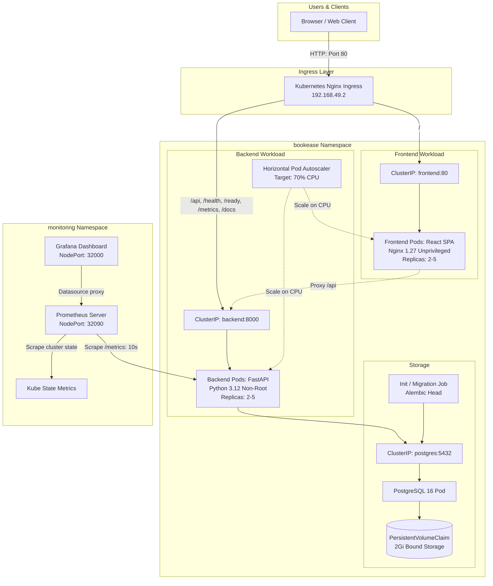
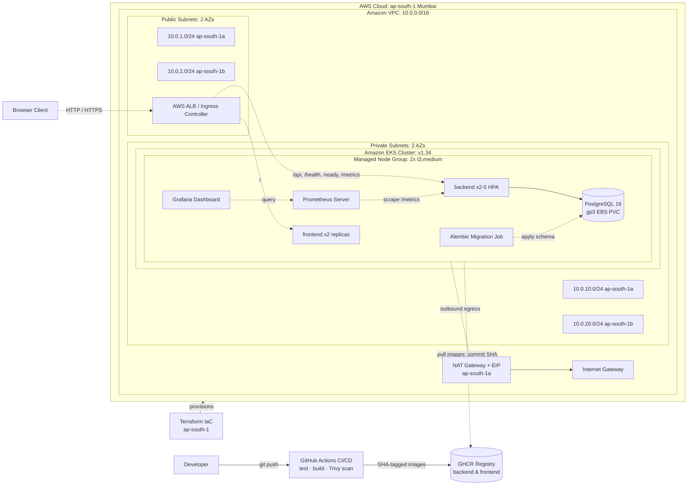
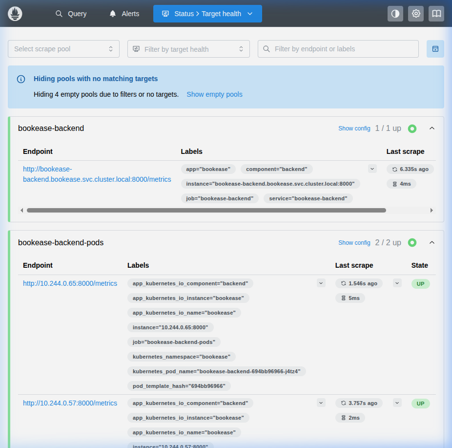

# BookEase — Medical Appointment Booking Management System
**Session 21 DevOps Final Capstone Project**

**An outpatient medical scheduling platform demonstrating a complete DevOps lifecycle:** automated backend unit tests (Pytest on isolated SQLite), multi-stage non-root containers, automated DevSecOps pipeline gates in GitHub Actions, immutable SHA-tagged images published to GitHub Container Registry (GHCR), local Kubernetes orchestration via Helm with Horizontal Pod Autoscaling (HPA v2), Prometheus and Grafana observability, and validated AWS Terraform Infrastructure as Code (targeting EKS v1.34 Standard Support).

[](https://github.com/Durgaprasad-Developer/session21-devops-capstone-final/actions/workflows/ci.yml)
[](docker-compose.yml)
[](helm/bookease/)
[](monitoring/)
[](terraform/)


---

## Highlights

- **Conflict-free appointment scheduling.** Validates physician availability hours and overlapping time slots; atomic database transactions prevent double-booking. The test suite exercises conflicting slots, edge-case hours, and invalid time ranges.
- **Automated CI/CD quality gates.** Automated GitHub Actions workflow checks backend tests, frontend build, Terraform HCL syntax/provider initialization, Gitleaks secrets scanning, Helm chart linting, Docker Compose integration smoke testing, Trivy container vulnerability scanning (`--exit-code 1` on HIGH/CRITICAL), and GHCR image publishing.
- **Hardened non-root containers.** Backend runs as unprivileged `appuser` (UID:GID 100:101); frontend runs on `nginxinc/nginx-unprivileged:1.27-alpine` (UID 101). Root access is dropped across all application workloads.
- **DevSecOps vulnerability controls.** Dependency CVEs (including Starlette CVE-2025-62727) remediated directly in code and base images, passing Trivy gates without suppressed findings.
- **Build once, deploy immutable bytes.** Each container image is built in CI, scanned, tagged with the exact Git commit SHA, and published to GitHub Container Registry (GHCR). Deployments trace directly to source commits.
- **Autoscaling & Observability.** Kubernetes HPA v2 scaled backend pods from 2 to 5 replicas under a simulated 35-worker load test surging CPU utilization to 240%, stabilizing cleanly back to 2 replicas. The Grafana dashboard tracks 6 panels covering active replicas, request throughput (>6,600 recorded during evaluation), p95/p99 latency, and error rates.
- **AWS Infrastructure as Code.** Amazon VPC (2 AZs, public & private subnets, NAT Gateway) and EKS control plane configured to **Kubernetes v1.34 Standard Support** (avoiding ~$360/month in legacy EKS Extended Support surcharges). All HCL files validated offline; live AWS provisioning held at $0.00 spend per capstone guidelines.

---

## What It Looks Like

<p align="center">
  
  
</p>
<p align="center"><sub>Live BookEase Clinical Scheduling Portal with Real-Time Doctor Availability, and Hospital Department Directory.</sub></p>

<p align="center">
  
  
</p>
<p align="center"><sub>Interactive FastAPI Swagger OpenAPI Documentation (/docs), and Appointments Booking Management.</sub></p>

<p align="center">
  
  
</p>
<p align="center"><sub>Doctor availability schedule management, and populated Grafana observability dashboard.</sub></p>

---

## Architecture Diagrams

### 1. Application & Workload Flow (Local Minikube Cluster)



### 2. AWS Deployment Architecture



> [!NOTE]
> **Architectural Boundary Note**: In the AWS deployment architecture, public subnets are tagged (`kubernetes.io/role/elb = 1`) to support the AWS Load Balancer Controller. The controller and ALB are deployment targets for a live cluster; they are not pre-installed in the offline Terraform configuration.

---

## Technology Stack

| Area | Tools & Versions | Purpose |
|---|---|---|
| **Frontend** | React 18, Vite 5, Nginx 1.27 (`nginx-unprivileged`) | Single Page Application & static delivery |
| **Backend** | Python 3.12, FastAPI 0.115+, SQLAlchemy 2.x, Pydantic v2 | High-performance asynchronous REST API |
| **Database** | PostgreSQL 16 Alpine, Alembic | Relational database & automated schema migrations |
| **Testing** | Pytest 8.x, SQLite in-memory | Isolated test suite with zero database dependencies |
| **Containers** | Docker (multi-stage, non-root), Docker Compose | Hardened local runtime |
| **CI/CD** | GitHub Actions | Automated build, test, and container publishing |
| **Security** | Trivy Container Scanner, Gitleaks | Automated CVE vulnerability & secret scanning gates |
| **Registry** | GitHub Container Registry (GHCR) | Public image repository with Git commit SHA tags |
| **IaC** | Terraform (v1.9.8, AWS Provider ~> 5.50) | Declarative VPC, Subnets, IGW/NAT, and EKS Cluster |
| **Orchestration** | Kubernetes v1.30 (on Minikube) / EKS v1.34 (Target), Helm v3 | Multi-replica deployments, Ingress, and persistence |
| **Autoscaling**| Kubernetes HPA v2 (Metrics Server) | Automatic horizontal scaling based on CPU |
| **Monitoring** | Prometheus, Grafana, Kube State Metrics | Live metric scraping, alerts, and dashboards |

---

## Repository Structure

```text
session21-devops-capstone-final/
├── .github/workflows/
│   └── ci.yml                     # 8-job GitHub Actions CI/CD + DevSecOps pipeline
├── backend/
│   ├── alembic/                   # Database migrations (001_initial_schema.py)
│   ├── app/                       # FastAPI application (routers, models, schemas, crud)
│   ├── tests/                     # 16 Pytest test cases & fixtures (conftest.py)
│   ├── Dockerfile                 # Hardened non-root Python 3.12 runtime (appuser)
│   ├── requirements.txt           # Production dependencies
│   └── pytest.ini                 # Pytest configuration
├── frontend/
│   ├── src/                       # React 18 SPA components & pages
│   ├── Dockerfile                 # Multi-stage Node builder + Nginx unprivileged runtime
│   ├── nginx.conf                 # Reverse proxy & SPA routing configuration
│   └── package.json               # Frontend dependencies
├── k8s/
│   └── namespace.yaml             # Dedicated bookease namespace manifest
├── helm/
│   └── bookease/                  # BookEase Helm chart (Deployments, Ingress, HPA, PVC)
├── monitoring/
│   ├── dashboards/                # Custom Grafana dashboard JSON (BookEase Observability)
│   ├── prometheus-values.yaml     # Prometheus Helm values & scrape configurations
│   ├── grafana-values.yaml        # Grafana Helm values & datasource provisioning
│   └── README.md                  # Monitoring setup and usage guide
├── terraform/
│   ├── main.tf, eks.tf, ...       # AWS VPC, Subnets, EKS Cluster v1.34, Node Group
│   ├── terraform.tfvars.example   # Safe configuration example (no credentials)
│   └── README.md                  # Infrastructure guide & deployment instructions
├── docs/
│   ├── API.md                     # Complete REST API reference and payload catalog
│   ├── DEPLOYMENT.md              # Extended deployment, EKS guide & cost details
│   ├── evidence/                  # Real command outputs (pytest, build, terraform, helm)
│   ├── presentation/              # PowerPoint presentation deck (.pptx)
│   ├── screenshots/               # Verified evidence screenshots (App, Targets, Grafana)
│   ├── PRESENTATION.md            # Slide-by-slide transcript & speaker notes
│   ├── DEMO_VIDEO_SCRIPT.md       # Scene-by-scene 5-7 minute video recording script
│   ├── DEMO.md                    # 5-minute presentation walkthrough guide
│   └── FINAL_AUDIT.md             # Complete rubric verification audit
├── demo/
│   └── BookEase_DevOps_Capstone_Presentation.pptx # Mirror copy of presentation deck
├── scripts/
│   └── generate_presentation.py   # Script to generate presentation deck
├── docker-compose.yml             # Local three-service development stack
├── .env.example                   # Environment configuration template
└── README.md                      # Project documentation
```

---

## Quick Start (Local Docker Compose)

### Prerequisites
- Docker Engine 24+ & Docker Compose v2+
- Python 3.12+ (optional, for local virtualenv development)
- Node.js 20+ (optional, for local frontend development)

### Start Full Stack
```bash
# 1. Copy environment template
cp .env.example .env

# 2. Build and start containers in background
docker compose up --build -d
```

| URL | Component | Purpose |
|---|---|---|
| `http://localhost:3000` | Frontend SPA | React clinical booking interface |
| `http://localhost:8000/docs` | Swagger UI | Interactive OpenAPI documentation |
| `http://localhost:8000/health` | Liveness Probe | Lightweight container healthcheck |
| `http://localhost:8000/ready` | Readiness Probe | Validates PostgreSQL database connectivity |
| `http://localhost:8000/metrics` | Prometheus Metrics | Machine-readable application metrics |

> [!NOTE]
> For complete endpoint schemas, payload specifications, and query parameters, see [docs/API.md](docs/API.md).

### Stop Docker Compose
```bash
# Stop containers and networks
docker compose down

# To also remove persistent volumes:
# CAUTION: The -v flag permanently deletes local PostgreSQL database volumes and data.
docker compose down -v
```

---

## Automated Testing & Code Quality

The backend includes 16 automated tests covering appointment booking, working-hour constraints, patient management, concurrent conflict detection, and health probes. Tests execute against an isolated in-memory SQLite database via `conftest.py` fixtures:

```bash
cd backend
source .venv/bin/activate
pip install -r requirements.txt
pytest -v
```

- **Actual Result**: `16 passed in 0.80s`
- **Committed Output**: [`docs/evidence/pytest_output.txt`](docs/evidence/pytest_output.txt)
- **Frontend Production Build**: `npm run build` succeeds cleanly in under 1 second ([`docs/evidence/frontend_build.txt`](docs/evidence/frontend_build.txt)).

---

## CI/CD Pipeline & DevSecOps Gates

The automated pipeline in [`.github/workflows/ci.yml`](.github/workflows/ci.yml) triggers on every push and pull request to `main`. 

The pipeline incorporates eight automated jobs:

```text
git push main
   │
   ├──► 1. test-backend (Pytest 16/16 on isolated SQLite) ─► Fails build on test regression
   ├──► 2. build-frontend (Vite compilation) ──────────────► Catches syntax and bundling bugs
   ├──► 3. validate-terraform (fmt, init, validate) ────────► Enforces AWS HCL syntax ($0 cloud spend)
   ├──► 4. scan-secrets (Gitleaks repository scan) ─────────► Blocks leaked credentials & API tokens
   ├──► 5. lint-helm (helm lint & helm template) ───────────► Validates Kubernetes chart manifests
   │
   ▼ (requires upstream quality gates to pass)
6. test-docker-compose (Integration smoke test) ───────────► Verifies /health & /ready probes, downs -v
   │
   ▼ (requires compose smoke test to pass)
7. build-and-scan (Trivy scanner on non-root images) ───────► Enforces exit-code 1 on HIGH/CRITICAL
   │
   ▼ (requires security scan to pass on main branch)
8. publish (Push to GHCR) ──────────────────────────────────► Tags immutable Git commit SHA + latest
```

- **Pipeline Evolution**: Baseline pipeline runs originally executed 4 core jobs (`test-backend`, `build-frontend`, `build-and-scan`, `publish`); this was subsequently expanded to 8 jobs to incorporate offline Terraform validation, Gitleaks secret scanning, Helm chart linting, and Docker Compose integration smoke testing.
- **Workflow Link**: Inspect live runs on [GitHub Actions CI/CD Pipeline](https://github.com/Durgaprasad-Developer/session21-devops-capstone-final/actions/workflows/ci.yml).
- **Gitleaks Secret Scanning**: Enforces zero credentials, private keys, or cloud tokens committed to git ([`docs/evidence/gitleaks_output.txt`](docs/evidence/gitleaks_output.txt)).
- **Terraform IaC Gate**: Runs `fmt -check`, `init -backend=false`, and `validate` offline without requiring AWS credentials ([`docs/evidence/terraform_validate.txt`](docs/evidence/terraform_validate.txt)).
- **Helm Manifest Validation**: Runs `helm lint` and `helm template` dry-run renders before any container build ([`docs/evidence/helm_lint.txt`](docs/evidence/helm_lint.txt)).
- **Docker Compose Smoke Gate**: Spins up live backend, frontend, and PostgreSQL services, verifies `/ready` and `/health`, and cleanly tears down ([`docs/evidence/docker_compose.txt`](docs/evidence/docker_compose.txt)).
- **Trivy Vulnerability Policy**: Strict security gate with `exit-code: 1` and `severity: 'CRITICAL,HIGH'`.
- **Remediated Vulnerabilities**: Upstream Starlette CVE-2025-62727 patched via FastAPI update; OS libraries updated via Alpine packages.
- **Immutable SHA Tags**: Published container images in GitHub Container Registry:
  - `ghcr.io/durgaprasad-developer/session21-devops-capstone-final/bookease-backend:<commit-sha>`
  - `ghcr.io/durgaprasad-developer/session21-devops-capstone-final/bookease-frontend:<commit-sha>`

---

## Kubernetes & Helm Deployment (Local Minikube)

### 1. Cluster Setup (Kubernetes v1.30 on Minikube)
```bash
minikube start --driver=docker --cpus=4 --memory=8192
minikube addons enable ingress
minikube addons enable metrics-server
```

### 2. Deploy BookEase Application
```bash
# Apply bootstrap namespace
kubectl apply -f k8s/namespace.yaml

# Deploy BookEase Helm chart
helm upgrade --install bookease ./helm/bookease \
  --namespace bookease \
  --create-namespace
```

### 3. Verify Pods, Services, and Ingress
```bash
kubectl get pods,svc,hpa,ingress -n bookease
```
- **Backend**: 2/2 replicas running as non-root `appuser:100:101`.
- **Frontend**: 2/2 replicas running as non-root `nginx:100:102`.
- **PostgreSQL**: Stateful workload bound to 2Gi PVC (`bookease-postgres-data`).
- **Migration Job**: Kubernetes Batch Job executed `alembic upgrade head` before serving traffic.
- **Ingress**: `http://192.168.49.2/` routes traffic cleanly across services.
- **Committed Verification**: [`docs/evidence/k8s_bookease_status.txt`](docs/evidence/k8s_bookease_status.txt) and [`docs/evidence/helm_lint.txt`](docs/evidence/helm_lint.txt).

### 4. Horizontal Pod Autoscaling (HPA v2) Verification
- **Target**: Average CPU utilization `70%`.
- **Range**: Min `2`, Max `5` replicas.
- **Live Stress Test**: Stressing `/api/doctors` with 35 concurrent workers surged CPU utilization to **240%**.
- **Autoscaling Response**: HPA scaled backend pods from **2 to 4**, and then to **5 replicas** (`maxReplicas`). Following load termination, pods stabilized back to 2 replicas.

---

## Observability (Prometheus + Grafana)

The monitoring stack is deployed in the `monitoring` namespace using maintained community Helm charts:

### Deploy Monitoring Stack
```bash
# 1. Add Helm repos
helm repo add prometheus-community https://prometheus-community.github.io/helm-charts
helm repo add grafana https://grafana.github.io/helm-charts
helm repo update

# 2. Deploy Dashboard ConfigMap
kubectl create configmap bookease-grafana-dashboards \
  --from-file=bookease-dashboard.json=monitoring/dashboards/bookease-dashboard.json \
  -n monitoring --dry-run=client -o yaml | kubectl apply -f -

# 3. Deploy Prometheus
helm upgrade --install prometheus prometheus-community/prometheus \
  -f monitoring/prometheus-values.yaml \
  -n monitoring --create-namespace

# 4. Deploy Grafana
helm upgrade --install grafana grafana/grafana \
  -f monitoring/grafana-values.yaml \
  -n monitoring
```

### Accessing Dashboards & Credential Security
| Component | Local Minikube URL | Port-Forward Alternative | Authentication |
|---|---|---|---|
| **Prometheus UI** | `http://192.168.49.2:32090` | `kubectl port-forward -n monitoring svc/prometheus-server 9090:9090` | None (internal scrape engine) |
| **Grafana UI** | `http://192.168.49.2:32000` | `kubectl port-forward -n monitoring svc/grafana 3000:80` | Configured via Kubernetes Secret or deployment parameter |

> [!IMPORTANT]
> **Grafana Credential Security**:
> In accordance with DevSecOps practices, Grafana admin passwords should be supplied dynamically via `--set adminPassword="$GRAFANA_ADMIN_PASSWORD"` or retrieved from an existing Kubernetes Secret (`admin.existingSecret`). Default passwords should never be committed into repository configuration files.

### Verified Dashboard Panels
- **Active Backend Replicas**: Live count of healthy pods (`count(up{job="bookease-backend-pods"} == 1)`).
- **Total Requests Served**: Cumulative HTTP requests (>6,600 recorded during evaluation).
- **HTTP Error Rate %**: Error proportion gauge (`0.00%`).
- **Request Latency (p95 & p99)**: Histograms calculated from bucket metrics.
- **Request Rate by Endpoint (req/s)**: Route-specific throughput.
- **Backend Process CPU & Memory**: CPU percentage and RSS memory bytes.
- **Committed Verification**: [`docs/evidence/metrics_output.txt`](docs/evidence/metrics_output.txt), [`docs/screenshots/prometheus_targets_up.png`](docs/screenshots/prometheus_targets_up.png), and [`docs/screenshots/grafana_bookease_dashboard.png`](docs/screenshots/grafana_bookease_dashboard.png).

<p align="center">
  
  
</p>
<p align="center"><sub>Live Prometheus scrape targets (1/1 UP) and Grafana 6-panel monitoring dashboard.</sub></p>

---

## AWS Infrastructure Design — Terraform Validated; Live Deployment Deferred

The `terraform/` directory defines an AWS cloud infrastructure designed for high availability and strict cost optimization:

### Architecture Summary
- **Amazon VPC**: Custom CIDR `10.0.0.0/16` with DNS hostnames and DNS support enabled in region `ap-south-1` (Mumbai).
- **Subnet Distribution (2 AZs)**:
  - 2 Public Subnets: `10.0.1.0/24` (`ap-south-1a`) and `10.0.2.0/24` (`ap-south-1b`), tagged with `kubernetes.io/role/elb = 1`.
  - 2 Private Subnets: `10.0.10.0/24` (`ap-south-1a`) and `10.0.20.0/24` (`ap-south-1b`), tagged with `kubernetes.io/role/internal-elb = 1`.
- **Egress Architecture**: Internet Gateway for public traffic and a single cost-optimized NAT Gateway with Elastic IP for private worker node outbound connectivity.
- **Amazon EKS Cluster**: Kubernetes v1.34 control plane (aligned with official AWS Standard Support through December 2026 to avoid extended support charges).
- **Core EKS Add-ons**: `vpc-cni`, `coredns`, and `kube-proxy` managed as first-class Terraform resources.
- **Managed Node Group**: 2x `t3.medium` instances (scaling 1–4 nodes) with 20 GiB gp3 root storage deployed into private subnets.
- **IAM Least Privilege**:
  - Control plane role with `AmazonEKSClusterPolicy` and `AmazonEKSVPCResourceController`.
  - Node group role with `AmazonEKSWorkerNodePolicy`, `AmazonEKS_CNI_Policy`, and `AmazonEC2ContainerRegistryReadOnly`.
- **Security Groups & State**: Granular control plane egress rules, with `.gitignore` strictly omitting all state files (`*.tfstate`), `.terraform/`, and local variables (`*.tfvars`).

### Offline Terraform Validation (Verified & Safe)
```bash
cd terraform
terraform fmt -check
terraform init -backend=false
terraform validate
```
- **Formatting**: `terraform fmt -check` passes with zero formatting issues.
- **Initialization**: `terraform init -backend=false` successfully resolves provider `hashicorp/aws v5.100.0`.
- **Validation Output**: `Success! The configuration is valid.` ([`docs/evidence/terraform_validate.txt`](docs/evidence/terraform_validate.txt)).

> [!IMPORTANT]
> **Validation Boundary & Live Provisioning Status**:
> Offline Terraform validation (`fmt`, `init`, `validate`) confirms the syntax, structure, and provider configurations are 100% correct. However, **active AWS provisioning (`terraform apply`), live cloud deployment, running EKS workloads, and `terraform destroy` were deferred** in accordance with instructor guidelines to maintain student cloud expenditure at **$0.00**. Detailed instructions for executing an authorized cloud deployment are documented in [docs/DEPLOYMENT.md](docs/DEPLOYMENT.md) and [terraform/README.md](terraform/README.md).

---

## Cost Comparison & Lifecycle Assumptions

Amazon EKS enforces a distinct pricing tier between **Standard Support** and **Extended Support**:

| Deployment Mode | Infrastructure Configuration | Daily Cost | Monthly Estimate | Notes & Rationale |
|---|---|---|---|---|
| **Local Minikube** | Docker engine on local workstation | **$0.00** | **$0.00** | **Verified live**. Zero cloud charges. All app, HPA, and monitoring requirements proven. |
| **AWS EKS Standard (v1.34)** | EKS control plane ($0.10/hr) + 2x `t3.medium` ($0.083/hr) + 1 NAT GW ($0.045/hr) + 40GB gp3 | **~$5.60** | **~$168.00** | **Our configured IaC target**. Standard support active through Dec 2026. Avoids extended support surcharges. |
| **AWS EKS Extended (v1.30)** | Deprecated control plane ($0.60/hr surcharge) + 2x `t3.medium` + NAT GW | **~$17.60** | **~$528.00** | Incurs an additional **$0.50/hour Extended Support surcharge** (~$360/mo support penalty). |

> [!TIP]
> **Extended Support Surcharge Avoidance**:
> Targeting Kubernetes v1.34 under AWS Standard Support avoids approximately **$360/month** ($0.50/hour) in EKS Extended Support surcharges that AWS levies on deprecated Kubernetes versions (such as v1.30). Note that this represents avoided support-tier penalties, not guaranteed total savings, as total cloud expenditure depends on active runtime and resource usage.

---

## Teardown & Safe Cleanup Instructions

To avoid lingering cloud charges or orphaned resources:

### 1. Cloud Infrastructure Teardown (AWS EKS)
```bash
# Step 1: Remove Helm workloads first (releases Ingress ENIs, ALBs, and PVCs)
helm uninstall bookease -n bookease
helm uninstall grafana -n monitoring 2>/dev/null || true
helm uninstall prometheus -n monitoring 2>/dev/null || true

# Step 2: Destroy Terraform infrastructure cleanly
cd terraform
terraform destroy -auto-approve
```

> [!WARNING]
> Always uninstall Helm releases before executing `terraform destroy`. If Kubernetes LoadBalancers or EBS PVCs are not deleted first, AWS will hold associated Network Interfaces and Security Groups, which will cause `terraform destroy` to fail on VPC deletion.

### 2. Local Environment Teardown (Minikube / Docker Compose)
```bash
# Stop local Minikube cluster
minikube stop

# Stop Docker Compose stack
# NOTE: The -v flag removes persistent volumes and permanently deletes local database data.
docker compose down -v
```

---

## Capstone Rubric Matrix (M1–M10)

This matrix maps each module of the Capstone Rubric (`projectDescriptionandGrading.md`) directly to its implementation files, verification commands, and proof artifacts in this repository:

| Module | Topic | Pts | Status | Repository Evidence & Verification Command | Verified Evidence Artifact |
|---|---|---|---|---|---|
| **M1** | Application Architecture | 10 | **Verified** | `backend/app/main.py`, `routers/`, `alembic/`, `frontend/`<br>`curl -s http://192.168.49.2/health` | [`docs/screenshots/bookease_dashboard.png`](docs/screenshots/bookease_dashboard.png)<br>[`docs/screenshots/fastapi_swagger_docs.png`](docs/screenshots/fastapi_swagger_docs.png)<br>[`docs/API.md`](docs/API.md) |
| **M2** | Testing & Code Quality | 10 | **Verified** | `backend/tests/` (16 unit tests on isolated SQLite DB)<br>`pytest -v` (16 passed in 0.80s) | [`docs/evidence/pytest_output.txt`](docs/evidence/pytest_output.txt)<br>[`docs/evidence/frontend_build.txt`](docs/evidence/frontend_build.txt) |
| **M3** | Git & GitHub Hygiene | 5 | **Verified** | Public repo, 15+ semantic commits, `.gitignore`<br>`git log --oneline` | [`docs/evidence/git_commit_history.txt`](docs/evidence/git_commit_history.txt)<br>[`docs/evidence/gitleaks_output.txt`](docs/evidence/gitleaks_output.txt) |
| **M4** | Docker & Compose | 10 | **Verified** | `backend/Dockerfile` (non-root `appuser`), `frontend/Dockerfile` (unprivileged Nginx)<br>`docker compose ps` | [`docs/evidence/docker_compose.txt`](docs/evidence/docker_compose.txt)<br>[`docs/evidence/docker_compose_status.txt`](docs/evidence/docker_compose_status.txt) |
| **M5** | CI/CD Pipeline | 15 | **Verified** | `.github/workflows/ci.yml` (8 automated jobs, SHA-tagged image publishing to GHCR)<br>Triggers on push/PR to `main` | [GitHub Actions Workflow](.github/workflows/ci.yml)<br>[Workflow Runs](https://github.com/Durgaprasad-Developer/session21-devops-capstone-final/actions/workflows/ci.yml) |
| **M6** | DevSecOps & Security | 5 | **Verified** | `aquasecurity/trivy-action` (`exit-code: 1`, `CRITICAL,HIGH`) + Gitleaks secret scanning<br>Remediated Starlette CVE-2025-62727, zero credential leaks | [`docs/evidence/gitleaks_output.txt`](docs/evidence/gitleaks_output.txt)<br>[CI Trivy Gate](.github/workflows/ci.yml) |
| **M7** | Terraform AWS IaC | 15 | **Verified** | `terraform/` (VPC, 4 subnets, NAT, EKS v1.34, Add-ons, Node Group)<br>`terraform validate` (100% offline syntax & provider verified) | [`docs/evidence/terraform_validate.txt`](docs/evidence/terraform_validate.txt)<br>[`terraform/README.md`](terraform/README.md) |
| **M8** | Kubernetes & Helm | 15 | **Verified** | `helm/bookease/` (12 templates, HPA v2 2→5 replicas, Ingress)<br>`kubectl get pods,svc,hpa -n bookease` (on local Minikube K8s v1.30) | [`docs/evidence/k8s_bookease_status.txt`](docs/evidence/k8s_bookease_status.txt)<br>[`docs/screenshots/ingress_application.png`](docs/screenshots/ingress_application.png) |
| **M9** | Observability | 10 | **Verified** | FastAPI `/metrics`, Prometheus server (UP), Grafana dashboard (6 live panels)<br>`curl http://192.168.49.2:32090/api/v1/targets` | [`docs/evidence/metrics_output.txt`](docs/evidence/metrics_output.txt)<br>[`docs/screenshots/prometheus_targets_up.png`](docs/screenshots/prometheus_targets_up.png)<br>[`docs/screenshots/grafana_bookease_dashboard.png`](docs/screenshots/grafana_bookease_dashboard.png) |
| **M10**| Presentation & Docs | 5 | **Verified** | Complete presentation slide deck (.pptx & Google Slides) and walkthrough guide | [Google Slides Presentation](https://docs.google.com/presentation/d/1hvEM9wmknlUbedzcnXgSMwg9Riph9KxaNyO3QIsm7Q4/edit?usp=sharing)<br>[`docs/presentation/BookEase_DevOps_Capstone_Presentation.pptx`](docs/presentation/BookEase_DevOps_Capstone_Presentation.pptx)<br>[`docs/DEMO.md`](docs/DEMO.md) |
| **Total** | | **100** | | Full grading verification audit | Detailed Review: [`docs/FINAL_AUDIT.md`](docs/FINAL_AUDIT.md) |

---

## Final Submission Deliverables & Links

- **Capstone Presentation (Google Slides)**: [Open Presentation in Google Slides](https://docs.google.com/presentation/d/1hvEM9wmknlUbedzcnXgSMwg9Riph9KxaNyO3QIsm7Q4/edit?usp=sharing)
- **PowerPoint Presentation Deck (.pptx)**: [`docs/presentation/BookEase_DevOps_Capstone_Presentation.pptx`](docs/presentation/BookEase_DevOps_Capstone_Presentation.pptx) (and mirror in [`demo/BookEase_DevOps_Capstone_Presentation.pptx`](demo/BookEase_DevOps_Capstone_Presentation.pptx))
- **Presentation Walkthrough Guide**: [`docs/DEMO.md`](docs/DEMO.md)
- **REST API Specification**: [`docs/API.md`](docs/API.md)
- **Extended Deployment & Teardown Guide**: [`docs/DEPLOYMENT.md`](docs/DEPLOYMENT.md)
- **Complete Rubric Verification Audit**: [`docs/FINAL_AUDIT.md`](docs/FINAL_AUDIT.md)
