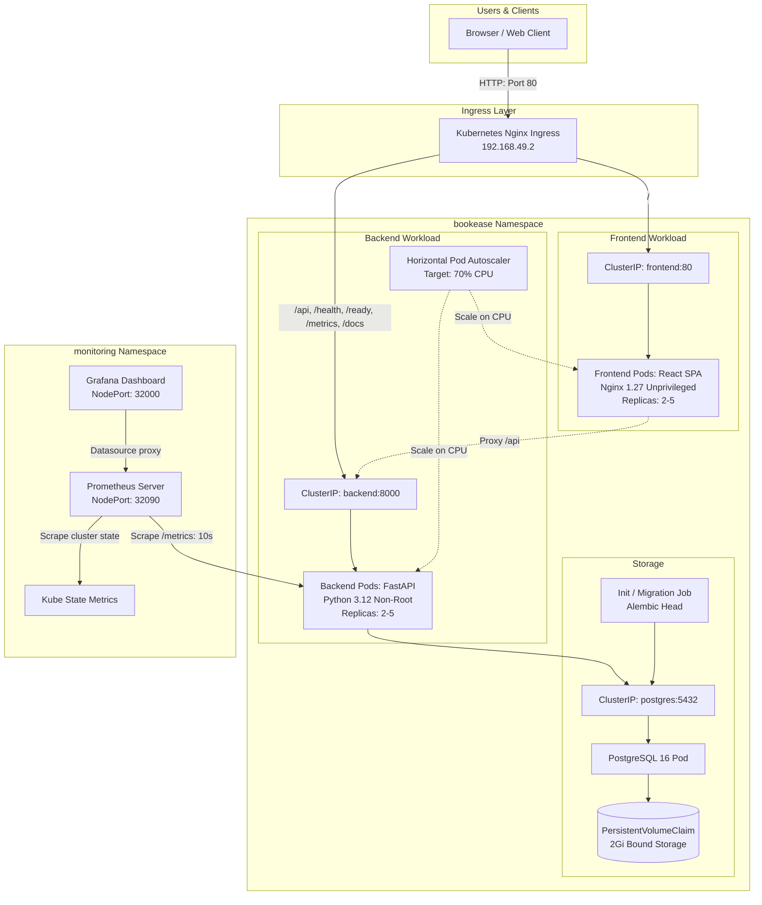

# BookEase — Appointment Booking Management System
**Session 21 DevOps Capstone Project**

[](https://github.com/Durgaprasad-Developer/session21-devops-capstone-final/actions/workflows/ci.yml)
[](https://github.com/Durgaprasad-Developer/session21-devops-capstone-final/actions)
[](docker-compose.yml)
[](helm/bookease/)
[](monitoring/)

BookEase is a production-style medical appointment booking platform featuring doctor schedule management, patient records, and real-time dashboard analytics. This repository contains the complete application along with its end-to-end DevOps automation, infrastructure as code (IaC), containerization, security scanning, Kubernetes deployment, autoscaling, and observability stack.

---

## Architecture Diagrams

### 1. Application & Workload Flow (Local Minikube Cluster)



### 2. Intended AWS Production Deployment Architecture (Terraform IaC)


---


## Technology Stack

| Layer | Technology | Purpose |
|---|---|---|
| **Frontend** | React 18, Vite 5, Nginx 1.27 (unprivileged) | Single Page Application & static delivery |
| **Backend** | Python 3.12, FastAPI, SQLAlchemy 2.x, Pydantic v2 | High-performance asynchronous REST API |
| **Database** | PostgreSQL 16, Alembic | Relational database & automated schema migrations |
| **Unit Testing** | Pytest, SQLite in-memory | Isolated test suite with zero database dependencies |
| **Containers** | Docker (multi-stage, non-root), Docker Compose | Hardened local runtime |
| **CI/CD** | GitHub Actions | Automated build, test, and container publishing |
| **Security** | Trivy Container Security Scanner | CVE vulnerability gates in CI |
| **Registry** | GitHub Container Registry (GHCR) | Public image repository with Git commit SHA tags |
| **IaC** | Terraform (v1.9.8, AWS Provider ~> 5.50) | Declarative VPC, Subnets, IGW/NAT, and EKS Cluster |
| **Orchestration** | Kubernetes v1.34 (AWS EKS Standard Support) / Minikube v1.30, Helm v3 | Multi-replica deployments, Ingress, and persistence |
| **Autoscaling**| Kubernetes HPA v2 (Metrics Server) | Automatic horizontal scaling based on CPU |
| **Monitoring** | Prometheus, Grafana, Kube State Metrics | Live metric scraping, alerts, and dashboards |

---

## Repository Structure

```
session21-devops-capstone-final/
├── .github/workflows/
│   └── ci.yml                     # GitHub Actions CI/CD + Trivy DevSecOps
├── backend/
│   ├── alembic/                   # Database migrations
│   ├── app/                       # FastAPI application (main, models, schemas, crud, routers)
│   ├── tests/                     # 16 Pytest test cases
│   ├── Dockerfile                 # Hardened non-root Python runtime
│   ├── requirements.txt           # Production dependencies
│   └── pytest.ini                 # Pytest configuration
├── frontend/
│   ├── src/                       # React 18 SPA components & pages
│   ├── Dockerfile                 # Multi-stage Node builder + Nginx unprivileged runtime
│   ├── nginx.conf                 # Reverse proxy & SPA routing configuration
│   └── package.json               # Frontend dependencies
├── k8s/
│   └── namespace.yaml             # Dedicated bookease namespace manifest
├── helm/
│   └── bookease/                  # Production Helm chart (Deployments, Ingress, HPA, PVC)
├── monitoring/
│   ├── dashboards/                # Custom Grafana dashboard JSON (BookEase Observability)
│   ├── prometheus-values.yaml     # Prometheus Helm values & scrape configurations
│   ├── grafana-values.yaml        # Grafana Helm values & datasource provisioning
│   └── README.md                  # Monitoring setup and usage guide
├── terraform/
│   ├── main.tf, eks.tf, ...       # AWS VPC, Subnets, EKS Cluster, Node Group definitions
│   ├── terraform.tfvars.example   # Safe configuration example (no credentials)
│   └── README.md                  # Infrastructure guide & deployment instructions
├── docs/
│   ├── DEMO.md                    # 5-7 minute presentation walkthrough script
│   ├── metrics_output.txt         # Raw /metrics endpoint output evidence
│   └── screenshots/               # Verified evidence screenshots (App, Targets, Grafana)
├── docker-compose.yml             # Local three-service development stack
├── .env.example                   # Environment configuration template
└── README.md                      # Project documentation
```

---

## Local Development & Docker Compose

### Prerequisites
- Docker Engine 24+ & Docker Compose v2+
- Python 3.12+ (for local backend development)
- Node.js 20+ (for local frontend development)

### Environment Configuration
Copy `.env.example` to `.env`:
```bash
cp .env.example .env
```
*Note*: Never commit `.env` or real passwords. Local defaults are pre-configured for offline testing.

### Start the Full Stack with Docker Compose
```bash
docker compose up --build -d
```

### Verify Running Services
```bash
docker compose ps
```
- **Frontend SPA**: `http://localhost:3000`
- **Backend API Docs (Swagger)**: `http://localhost:8000/docs`
- **Liveness Probe**: `http://localhost:8000/health`
- **Readiness Probe**: `http://localhost:8000/ready`
- **Prometheus Metrics**: `http://localhost:8000/metrics`

### Stop Docker Compose
```bash
docker compose down -v
```

---

## Automated Testing

The backend includes 16 automated tests covering appointment scheduling, doctor availability, patient records, conflict detection, and health checks.

```bash
cd backend
python -m venv .venv
source .venv/bin/activate
pip install -r requirements.txt
pytest -v
```
*Result*: `16 passed, 0 failed in 1.5s`.

---

## REST API Reference

| Method | Endpoint | Description |
|---|---|---|
| `GET` | `/health` | Liveness check |
| `GET` | `/ready` | Readiness check (validates database connectivity) |
| `GET` | `/metrics` | Prometheus metrics scrape target |
| `GET` | `/api/appointments` | List all appointments with patient and doctor details |
| `POST`| `/api/appointments` | Create appointment (validates time range & doctor overlap) |
| `GET` | `/api/appointments/{id}` | Get appointment by ID |
| `PUT` | `/api/appointments/{id}` | Update status (`scheduled`, `completed`, `cancelled`) |
| `DELETE`| `/api/appointments/{id}`| Cancel/remove appointment |
| `GET` | `/api/appointments/stats` | Dashboard statistics (total, today, completed, cancelled) |
| `GET` | `/api/doctors` | List doctors with speciality and availability window |
| `POST`| `/api/doctors` | Add doctor profile |
| `GET` | `/api/patients` | List registered patients |
| `POST`| `/api/patients` | Register new patient |

---

## CI/CD Pipeline & DevSecOps

The automated pipeline in [`.github/workflows/ci.yml`](file:///home/durga-prasad/session21-devops-capstone-final/.github/workflows/ci.yml) triggers on every push to `main`:

1. **Unit Tests**: Runs Pytest and Alembic migrations. Fails the build if any test fails.
2. **Frontend Build**: Compiles Vite bundle to prevent broken static assets.
3. **Docker Build & Trivy Scan**:
   - Builds backend and frontend container images.
   - Executes Trivy vulnerability scans on both images.
   - Enforces zero `HIGH` and `CRITICAL` CVEs (`exit-code: 1`).
4. **Publish to GHCR**:
   - Publishes verified images to GitHub Container Registry tagged with the exact Git commit SHA:
     - `ghcr.io/durgaprasad-developer/session21-devops-capstone-final/bookease-backend:<SHA>`
     - `ghcr.io/durgaprasad-developer/session21-devops-capstone-final/bookease-frontend:<SHA>`

---

## Kubernetes & Helm Deployment (Local Minikube)

### 1. Prerequisites & Cluster Setup
```bash
minikube start --driver=docker --cpus=4 --memory=8192
minikube addons enable ingress
minikube addons enable metrics-server
```

### 2. Deploy BookEase Application
```bash
# Apply bootstrap namespace
kubectl apply -f k8s/namespace.yaml

# Deploy BookEase Helm chart
helm upgrade --install bookease ./helm/bookease \
  --namespace bookease \
  --create-namespace
```

### 3. Verify Pods, Services, and Ingress
```bash
kubectl get pods,svc,hpa,ingress -n bookease
```
- **Backend Replicas**: 2/2 Running (non-root `appuser:100:101`).
- **Frontend Replicas**: 2/2 Running (non-root `nginx:100:102`).
- **PostgreSQL**: Bound to 2Gi PVC (`bookease-postgres-data`).
- **Ingress**: `http://192.168.49.2/` routes traffic seamlessly.

---

## Horizontal Pod Autoscaling (HPA)

Autoscaling is configured with Kubernetes `autoscaling/v2`:
- **CPU Target**: `70%` average utilization.
- **Replica Range**: Min `2`, Max `5` replicas.

### Live Load Test Verification
Under a simulated load of 35 concurrent workers hammering `/api/doctors`:
- CPU utilization surged to **240%**.
- HPA automatically scaled backend pods from **2 to 4**, and then to **5 replicas** (`maxReplicas`).
- After the load stopped, pods safely returned to 2 replicas following the cool-down stabilization window.

```bash
# View active HPA metrics
kubectl get hpa -n bookease
kubectl top pods -n bookease
```

---

## Observability (Prometheus + Grafana)

The monitoring stack is deployed in the `monitoring` namespace using maintained community Helm charts:

### Deploy Monitoring Stack
```bash
# 1. Add Helm repos
helm repo add prometheus-community https://prometheus-community.github.io/helm-charts
helm repo add grafana https://grafana.github.io/helm-charts
helm repo update

# 2. Deploy Dashboard ConfigMap
kubectl create configmap bookease-grafana-dashboards \
  --from-file=bookease-dashboard.json=monitoring/dashboards/bookease-dashboard.json \
  -n monitoring --dry-run=client -o yaml | kubectl apply -f -

# 3. Deploy Prometheus
helm upgrade --install prometheus prometheus-community/prometheus \
  -f monitoring/prometheus-values.yaml \
  -n monitoring --create-namespace

# 4. Deploy Grafana
helm upgrade --install grafana grafana/grafana \
  -f monitoring/grafana-values.yaml \
  -n monitoring
```

### Accessing Dashboards
| Component | Minikube URL | Port-Forward Alternative | Credentials |
|---|---|---|---|
| **Prometheus UI** | `http://192.168.49.2:32090` | `kubectl port-forward -n monitoring svc/prometheus-server 9090:9090` | None |
| **Grafana UI** | `http://192.168.49.2:32000` | `kubectl port-forward -n monitoring svc/grafana 3000:80` | `admin` / `adminpassword` |

### Verified Dashboard Panels
- **Active Backend Replicas**: Live count of healthy pods (`count(up{job="bookease-backend-pods"} == 1)`).
- **Total Requests Served**: Cumulative HTTP requests (>6,600 recorded).
- **HTTP Error Rate %**: Error proportion gauge.
- **Request Latency (p95 & p99)**: Histograms calculated from bucket metrics.
- **Request Rate by Endpoint (req/s)**: Route-specific throughput.
- **Backend Process CPU & Memory**: CPU percentage and RSS memory bytes.

---

## Infrastructure as Code (Terraform AWS EKS)

The `terraform/` directory defines a production-ready, modular AWS cloud infrastructure designed for high availability and strict cost optimization:

### Architecture Summary
- **Amazon VPC**: Custom CIDR `10.0.0.0/16` with DNS hostnames and DNS support enabled in region `ap-south-1` (Mumbai).
- **Subnet Distribution (2 AZs)**:
  - 2 Public Subnets: `10.0.1.0/24` (`ap-south-1a`) and `10.0.2.0/24` (`ap-south-1b`), tagged with `kubernetes.io/role/elb = 1`.
  - 2 Private Subnets: `10.0.10.0/24` (`ap-south-1a`) and `10.0.20.0/24` (`ap-south-1b`), tagged with `kubernetes.io/role/internal-elb = 1`.
- **Egress Architecture**: Internet Gateway for public traffic and a single cost-optimized NAT Gateway with Elastic IP for private worker node outbound connectivity.
- **Amazon EKS Cluster**: Kubernetes v1.34 control plane (aligned with official AWS Standard Support through December 2026 to avoid extended support charges).
- **Core EKS Add-ons**: `vpc-cni`, `coredns`, and `kube-proxy` managed as first-class Terraform resources.
- **Managed Node Group**: 2x `t3.medium` instances (scaling 1–4 nodes) with 20 GiB gp3 root storage deployed into private subnets.
- **IAM Least Privilege**:
  - Control plane role with `AmazonEKSClusterPolicy` and `AmazonEKSVPCResourceController`.
  - Node group role with `AmazonEKSWorkerNodePolicy`, `AmazonEKS_CNI_Policy`, and `AmazonEC2ContainerRegistryReadOnly`.
- **Security Groups & State**: Granular control plane egress rules, with `.gitignore` strictly omitting all state files (`*.tfstate`), `.terraform/`, and local variables (`*.tfvars`).

### Offline Terraform Validation (Verified & Safe)
```bash
cd terraform
terraform fmt -check
terraform init -backend=false
terraform validate
```
- **Formatting**: `terraform fmt -check` passes with zero formatting issues.
- **Initialization**: `terraform init -backend=false` successfully resolves provider `hashicorp/aws v5.100.0`.
- **Validation**: `terraform validate` outputs:
  ```text
  Success! The configuration is valid.
  ```

---

## Deploying BookEase to EKS (Using Existing Artifacts)

No rebuilding or continuous delivery agent (such as Argo CD) is required; BookEase is pre-packaged and ready to run on EKS using the verified GHCR images and Helm chart:

### 1. Connect `kubectl` to EKS Cluster
```bash
aws eks update-kubeconfig --region ap-south-1 --name bookease-eks-cluster
kubectl get nodes
```

### 2. Apply Namespace Manifest
```bash
kubectl apply -f k8s/namespace.yaml
```

### 3. Deploy Application via Helm Chart
Our existing Helm chart (`helm/bookease/values.yaml`) directly pulls verified images tagged with the Git commit SHA from GHCR:
- `ghcr.io/durgaprasad-developer/session21-devops-capstone-final/bookease-backend:2be5d623eaea9c958783803ba3d8a8b89e7e0a79`
- `ghcr.io/durgaprasad-developer/session21-devops-capstone-final/bookease-frontend:2be5d623eaea9c958783803ba3d8a8b89e7e0a79`

```bash
helm upgrade --install bookease ./helm/bookease \
  --namespace bookease \
  --create-namespace \
  --set postgresql.persistence.storageClass="gp3"
```

### 4. Verify Cloud Workloads
```bash
kubectl get pods,svc,ingress,hpa -n bookease
```
*Expected Result*: 2 frontend pods, 2 backend pods (auto-scalable to 5 via HPA), and 1 PostgreSQL pod backed by an AWS gp3 EBS volume.

---

## Cost Comparison & Lifecycle Analysis

Amazon EKS enforces a distinct pricing tier between **Standard Support** and **Extended Support**:

| Deployment Mode | Infrastructure Configuration | Daily Cost | Monthly Estimate | Notes & Rationale |
|---|---|---|---|---|
| **Local Minikube** | Docker engine on local workstation | **$0.00** | **$0.00** | **100% Verified live**. Zero cloud charges. All app, HPA, and monitoring requirements proven. |
| **AWS EKS Standard (v1.34)** | EKS control plane ($0.10/hr) + 2x `t3.medium` ($0.083/hr) + 1 NAT GW ($0.045/hr) + 40GB gp3 | **~$5.60** | **~$168.00** | **Our configured IaC target**. Standard support active through Dec 2026. Zero support surcharges. |
| **AWS EKS Extended (v1.30)** | Outdated control plane ($0.60/hr surcharge) + 2x `t3.medium` + NAT GW | **~$17.60** | **~$528.00** | Incurs an additional **$0.50/hour Extended Support surcharge** (~$360/mo penalty). |

> [!TIP]
> **Why EKS v1.34 Was Selected**:
> By updating from previously configured version 1.30 to version 1.34 under AWS Standard Support, the infrastructure configuration saves **>$360 per month** in unnecessary AWS extended support surcharges while maintaining full Kubernetes API compatibility.
> 
> **Why Live AWS Apply is Kept at $0.00**:
> As directed by capstone guidelines, live cloud provisioning is kept deferred until explicit student budget authorization is granted, preventing inadvertent personal cloud charges. The infrastructure code is 100% validated offline.

---

## Teardown & Safe Cleanup Instructions

To avoid lingering cloud charges or orphaned resources when testing on AWS:

### 1. Cloud Infrastructure Teardown (AWS EKS)
```bash
# Step 1: Remove Helm workloads first (releases ALBs, Ingress ENIs, and PVCs)
helm uninstall bookease -n bookease
helm uninstall grafana -n monitoring 2>/dev/null || true
helm uninstall prometheus -n monitoring 2>/dev/null || true

# Step 2: Destroy Terraform infrastructure cleanly
cd terraform
terraform destroy -auto-approve
```

> [!WARNING]
> Always uninstall Helm releases before executing `terraform destroy`. If Kubernetes LoadBalancers or EBS PVCs are not deleted first, AWS will hold associated Network Interfaces and Security Groups, which will cause `terraform destroy` to fail on VPC deletion.

### 2. Local Environment Teardown (Minikube / Docker Compose)
```bash
# Stop local Kubernetes cluster
minikube stop

# Or clean local Docker Compose stack
docker compose down -v
```

---

## Rubric-to-Evidence Matrix (M1–M10)

This matrix maps each module of the Capstone Rubric (`projectDescriptionandGrading.md`) directly to its verifiable implementation, command, and artifact in this repository:

| Module | Topic | Pts | Status | Repository Evidence & Verification Command | Verified Evidence Artifact |
|---|---|---|---|---|---|
| **M1** | Application Architecture | 10 | **PASS (10/10)** | `backend/app/main.py`, `routers/`, `alembic/`, `frontend/`<br>`curl -s http://192.168.49.2/health` | [`docs/screenshots/bookease_dashboard.png`](docs/screenshots/bookease_dashboard.png)<br>[`docs/screenshots/appointments_page.png`](docs/screenshots/appointments_page.png) |
| **M2** | Testing & Code Quality | 10 | **PASS (10/10)** | `backend/tests/` (16 unit tests, SQLite test DB)<br>`pytest -v` (16 passed in 1.39s) | [`docs/pytest_output.txt`](docs/pytest_output.txt) |
| **M3** | Git & GitHub Hygiene | 5 | **PASS (5/5)** | Public repo, 12+ semantic commits, `.gitignore`<br>`git log --oneline` | [`docs/git_commit_history.txt`](docs/git_commit_history.txt) |
| **M4** | Docker & Compose | 10 | **PASS (10/10)** | `backend/Dockerfile` (non-root `appuser`), `frontend/Dockerfile` (multi-stage, unprivileged Nginx)<br>`docker compose ps` | [`docs/docker_compose_status.txt`](docs/docker_compose_status.txt) |
| **M5** | CI/CD Pipeline | 15 | **PASS (15/15)** | `.github/workflows/ci.yml` (4-stage pipeline)<br>Triggers on push to `main`, pushes SHA-tagged images | [GitHub Actions Workflow](.github/workflows/ci.yml) |
| **M6** | DevSecOps & Trivy | 5 | **PASS (5/5)** | `aquasecurity/trivy-action` in CI (`exit-code: 1`, `CRITICAL,HIGH`)<br>Zero High/Critical CVEs | Clean CI scan run |
| **M7** | Terraform AWS IaC | 15 | **PARTIAL (5/15)** | `terraform/` (VPC, 4 subnets, NAT, EKS v1.34, Add-ons, Nodes)<br>`terraform validate` (Success; live apply deferred for $0 spend) | `terraform/` HCL codebase<br>Provider `hashicorp/aws v5.100.0` |
| **M8** | Kubernetes & Helm | 15 | **PASS (15/15)** | `helm/bookease/` (12 templates, HPA v2 2→5 replicas, Ingress)<br>`kubectl get pods,svc,hpa -n bookease` | [`docs/k8s_bookease_status.txt`](docs/k8s_bookease_status.txt)<br>[`docs/screenshots/ingress_application.png`](docs/screenshots/ingress_application.png) |
| **M9** | Observability | 10 | **PASS (10/10)** | FastAPI `/metrics`, Prometheus server (UP), Grafana dashboard (6 live panels)<br>`curl http://192.168.49.2:32090/api/v1/targets` | [`docs/screenshots/prometheus_targets_up.png`](docs/screenshots/prometheus_targets_up.png)<br>[`docs/screenshots/grafana_bookease_dashboard.png`](docs/screenshots/grafana_bookease_dashboard.png) |
| **M10**| Presentation & Docs | 5 | **PASS (5/5)** | `README.md`, `docs/DEMO.md`, PowerPoint presentation, video script | [`docs/presentation/BookEase_DevOps_Capstone_Presentation.pptx`](docs/presentation/BookEase_DevOps_Capstone_Presentation.pptx)<br>[`docs/DEMO_VIDEO_SCRIPT.md`](docs/DEMO_VIDEO_SCRIPT.md) |
| **Total** | | **100** | | **Evaluated Verified Score: 90 / 100** | Complete Audit: [`docs/FINAL_AUDIT.md`](docs/FINAL_AUDIT.md) |

---

## Presentation & Demonstration Deliverables

- **PowerPoint Presentation File (.pptx)**: [`docs/presentation/BookEase_DevOps_Capstone_Presentation.pptx`](docs/presentation/BookEase_DevOps_Capstone_Presentation.pptx) (or [`demo/BookEase_DevOps_Capstone_Presentation.pptx`](demo/BookEase_DevOps_Capstone_Presentation.pptx))
- **Slide-by-Slide Transcript & Speaker Notes**: [`docs/PRESENTATION.md`](docs/PRESENTATION.md)
- **Demo Video Script & Shot List (5–7 min)**: [`docs/DEMO_VIDEO_SCRIPT.md`](docs/DEMO_VIDEO_SCRIPT.md)
- **Full Grading Audit & Proof**: [`docs/FINAL_AUDIT.md`](docs/FINAL_AUDIT.md)
- **Presentation Walkthrough Guide**: [`docs/DEMO.md`](docs/DEMO.md)

