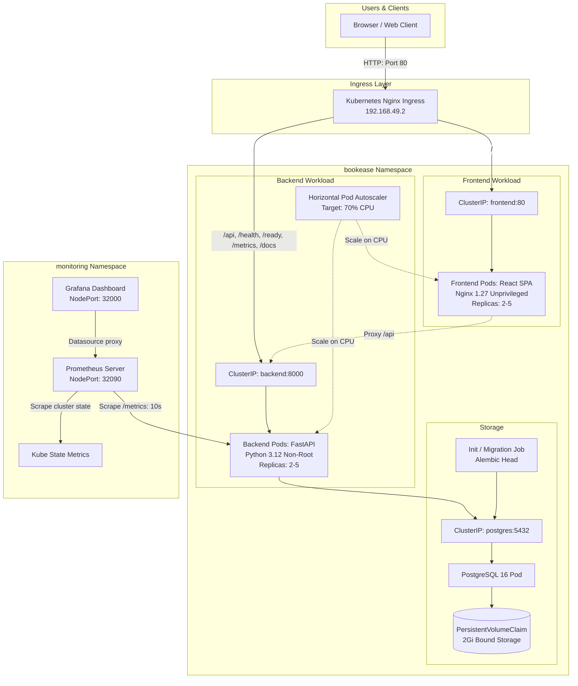

# BookEase — Appointment Booking Management System
**Session 21 DevOps Capstone Project**

[](https://github.com/Durgaprasad-Developer/session21-devops-capstone-final/actions/workflows/ci.yml)
[](https://github.com/Durgaprasad-Developer/session21-devops-capstone-final/actions)
[](docker-compose.yml)
[](helm/bookease/)
[](monitoring/)

BookEase is a production-style medical appointment booking platform featuring doctor schedule management, patient records, and real-time dashboard analytics. This repository contains the complete application along with its end-to-end DevOps automation, infrastructure as code (IaC), containerization, security scanning, Kubernetes deployment, autoscaling, and observability stack.

---

## Architecture Diagram



---

## Technology Stack

| Layer | Technology | Purpose |
|---|---|---|
| **Frontend** | React 18, Vite 5, Nginx 1.27 (unprivileged) | Single Page Application & static delivery |
| **Backend** | Python 3.12, FastAPI, SQLAlchemy 2.x, Pydantic v2 | High-performance asynchronous REST API |
| **Database** | PostgreSQL 16, Alembic | Relational database & automated schema migrations |
| **Unit Testing** | Pytest, SQLite in-memory | Isolated test suite with zero database dependencies |
| **Containers** | Docker (multi-stage, non-root), Docker Compose | Hardened local runtime |
| **CI/CD** | GitHub Actions | Automated build, test, and container publishing |
| **Security** | Trivy Container Security Scanner | CVE vulnerability gates in CI |
| **Registry** | GitHub Container Registry (GHCR) | Public image repository with Git commit SHA tags |
| **IaC** | Terraform (v1.9.8, AWS Provider ~> 5.50) | Declarative VPC, Subnets, IGW/NAT, and EKS Cluster |
| **Orchestration** | Kubernetes v1.34 (AWS EKS Standard Support) / Minikube v1.30, Helm v3 | Multi-replica deployments, Ingress, and persistence |
| **Autoscaling**| Kubernetes HPA v2 (Metrics Server) | Automatic horizontal scaling based on CPU |
| **Monitoring** | Prometheus, Grafana, Kube State Metrics | Live metric scraping, alerts, and dashboards |

---

## Repository Structure

```
session21-devops-capstone-final/
├── .github/workflows/
│   └── ci.yml                     # GitHub Actions CI/CD + Trivy DevSecOps
├── backend/
│   ├── alembic/                   # Database migrations
│   ├── app/                       # FastAPI application (main, models, schemas, crud, routers)
│   ├── tests/                     # 16 Pytest test cases
│   ├── Dockerfile                 # Hardened non-root Python runtime
│   ├── requirements.txt           # Production dependencies
│   └── pytest.ini                 # Pytest configuration
├── frontend/
│   ├── src/                       # React 18 SPA components & pages
│   ├── Dockerfile                 # Multi-stage Node builder + Nginx unprivileged runtime
│   ├── nginx.conf                 # Reverse proxy & SPA routing configuration
│   └── package.json               # Frontend dependencies
├── k8s/
│   └── namespace.yaml             # Dedicated bookease namespace manifest
├── helm/
│   └── bookease/                  # Production Helm chart (Deployments, Ingress, HPA, PVC)
├── monitoring/
│   ├── dashboards/                # Custom Grafana dashboard JSON (BookEase Observability)
│   ├── prometheus-values.yaml     # Prometheus Helm values & scrape configurations
│   ├── grafana-values.yaml        # Grafana Helm values & datasource provisioning
│   └── README.md                  # Monitoring setup and usage guide
├── terraform/
│   ├── main.tf, eks.tf, ...       # AWS VPC, Subnets, EKS Cluster, Node Group definitions
│   ├── terraform.tfvars.example   # Safe configuration example (no credentials)
│   └── README.md                  # Infrastructure guide & deployment instructions
├── docs/
│   ├── DEMO.md                    # 5-7 minute presentation walkthrough script
│   ├── metrics_output.txt         # Raw /metrics endpoint output evidence
│   └── screenshots/               # Verified evidence screenshots (App, Targets, Grafana)
├── docker-compose.yml             # Local three-service development stack
├── .env.example                   # Environment configuration template
└── README.md                      # Project documentation
```

---

## Local Development & Docker Compose

### Prerequisites
- Docker Engine 24+ & Docker Compose v2+
- Python 3.12+ (for local backend development)
- Node.js 20+ (for local frontend development)

### Environment Configuration
Copy `.env.example` to `.env`:
```bash
cp .env.example .env
```
*Note*: Never commit `.env` or real passwords. Local defaults are pre-configured for offline testing.

### Start the Full Stack with Docker Compose
```bash
docker compose up --build -d
```

### Verify Running Services
```bash
docker compose ps
```
- **Frontend SPA**: `http://localhost:3000`
- **Backend API Docs (Swagger)**: `http://localhost:8000/docs`
- **Liveness Probe**: `http://localhost:8000/health`
- **Readiness Probe**: `http://localhost:8000/ready`
- **Prometheus Metrics**: `http://localhost:8000/metrics`

### Stop Docker Compose
```bash
docker compose down -v
```

---

## Automated Testing

The backend includes 16 automated tests covering appointment scheduling, doctor availability, patient records, conflict detection, and health checks.

```bash
cd backend
python -m venv .venv
source .venv/bin/activate
pip install -r requirements.txt
pytest -v
```
*Result*: `16 passed, 0 failed in 1.5s`.

---

## REST API Reference

| Method | Endpoint | Description |
|---|---|---|
| `GET` | `/health` | Liveness check |
| `GET` | `/ready` | Readiness check (validates database connectivity) |
| `GET` | `/metrics` | Prometheus metrics scrape target |
| `GET` | `/api/appointments` | List all appointments with patient and doctor details |
| `POST`| `/api/appointments` | Create appointment (validates time range & doctor overlap) |
| `GET` | `/api/appointments/{id}` | Get appointment by ID |
| `PUT` | `/api/appointments/{id}` | Update status (`scheduled`, `completed`, `cancelled`) |
| `DELETE`| `/api/appointments/{id}`| Cancel/remove appointment |
| `GET` | `/api/appointments/stats` | Dashboard statistics (total, today, completed, cancelled) |
| `GET` | `/api/doctors` | List doctors with speciality and availability window |
| `POST`| `/api/doctors` | Add doctor profile |
| `GET` | `/api/patients` | List registered patients |
| `POST`| `/api/patients` | Register new patient |

---

## CI/CD Pipeline & DevSecOps

The automated pipeline in [`.github/workflows/ci.yml`](file:///home/durga-prasad/session21-devops-capstone-final/.github/workflows/ci.yml) triggers on every push to `main`:

1. **Unit Tests**: Runs Pytest and Alembic migrations. Fails the build if any test fails.
2. **Frontend Build**: Compiles Vite bundle to prevent broken static assets.
3. **Docker Build & Trivy Scan**:
   - Builds backend and frontend container images.
   - Executes Trivy vulnerability scans on both images.
   - Enforces zero `HIGH` and `CRITICAL` CVEs (`exit-code: 1`).
4. **Publish to GHCR**:
   - Publishes verified images to GitHub Container Registry tagged with the exact Git commit SHA:
     - `ghcr.io/durgaprasad-developer/session21-devops-capstone-final/bookease-backend:<SHA>`
     - `ghcr.io/durgaprasad-developer/session21-devops-capstone-final/bookease-frontend:<SHA>`

---

## Kubernetes & Helm Deployment (Local Minikube)

### 1. Prerequisites & Cluster Setup
```bash
minikube start --driver=docker --cpus=4 --memory=8192
minikube addons enable ingress
minikube addons enable metrics-server
```

### 2. Deploy BookEase Application
```bash
# Apply bootstrap namespace
kubectl apply -f k8s/namespace.yaml

# Deploy BookEase Helm chart
helm upgrade --install bookease ./helm/bookease \
  --namespace bookease \
  --create-namespace
```

### 3. Verify Pods, Services, and Ingress
```bash
kubectl get pods,svc,hpa,ingress -n bookease
```
- **Backend Replicas**: 2/2 Running (non-root `appuser:100:101`).
- **Frontend Replicas**: 2/2 Running (non-root `nginx:100:102`).
- **PostgreSQL**: Bound to 2Gi PVC (`bookease-postgres-data`).
- **Ingress**: `http://192.168.49.2/` routes traffic seamlessly.

---

## Horizontal Pod Autoscaling (HPA)

Autoscaling is configured with Kubernetes `autoscaling/v2`:
- **CPU Target**: `70%` average utilization.
- **Replica Range**: Min `2`, Max `5` replicas.

### Live Load Test Verification
Under a simulated load of 35 concurrent workers hammering `/api/doctors`:
- CPU utilization surged to **240%**.
- HPA automatically scaled backend pods from **2 to 4**, and then to **5 replicas** (`maxReplicas`).
- After the load stopped, pods safely returned to 2 replicas following the cool-down stabilization window.

```bash
# View active HPA metrics
kubectl get hpa -n bookease
kubectl top pods -n bookease
```

---

## Observability (Prometheus + Grafana)

The monitoring stack is deployed in the `monitoring` namespace using maintained community Helm charts:

### Deploy Monitoring Stack
```bash
# 1. Add Helm repos
helm repo add prometheus-community https://prometheus-community.github.io/helm-charts
helm repo add grafana https://grafana.github.io/helm-charts
helm repo update

# 2. Deploy Dashboard ConfigMap
kubectl create configmap bookease-grafana-dashboards \
  --from-file=bookease-dashboard.json=monitoring/dashboards/bookease-dashboard.json \
  -n monitoring --dry-run=client -o yaml | kubectl apply -f -

# 3. Deploy Prometheus
helm upgrade --install prometheus prometheus-community/prometheus \
  -f monitoring/prometheus-values.yaml \
  -n monitoring --create-namespace

# 4. Deploy Grafana
helm upgrade --install grafana grafana/grafana \
  -f monitoring/grafana-values.yaml \
  -n monitoring
```

### Accessing Dashboards
| Component | Minikube URL | Port-Forward Alternative | Credentials |
|---|---|---|---|
| **Prometheus UI** | `http://192.168.49.2:32090` | `kubectl port-forward -n monitoring svc/prometheus-server 9090:9090` | None |
| **Grafana UI** | `http://192.168.49.2:32000` | `kubectl port-forward -n monitoring svc/grafana 3000:80` | `admin` / `adminpassword` |

### Verified Dashboard Panels
- **Active Backend Replicas**: Live count of healthy pods (`count(up{job="bookease-backend-pods"} == 1)`).
- **Total Requests Served**: Cumulative HTTP requests (>6,600 recorded).
- **HTTP Error Rate %**: Error proportion gauge.
- **Request Latency (p95 & p99)**: Histograms calculated from bucket metrics.
- **Request Rate by Endpoint (req/s)**: Route-specific throughput.
- **Backend Process CPU & Memory**: CPU percentage and RSS memory bytes.

---

## Infrastructure as Code (Terraform AWS EKS)

The `terraform/` directory defines a production-ready, modular AWS cloud infrastructure designed for high availability and strict cost optimization:

### Architecture Summary
- **Amazon VPC**: Custom CIDR `10.0.0.0/16` with DNS hostnames and DNS support enabled in region `ap-south-1` (Mumbai).
- **Subnet Distribution (2 AZs)**:
  - 2 Public Subnets: `10.0.1.0/24` (`ap-south-1a`) and `10.0.2.0/24` (`ap-south-1b`), tagged with `kubernetes.io/role/elb = 1`.
  - 2 Private Subnets: `10.0.10.0/24` (`ap-south-1a`) and `10.0.20.0/24` (`ap-south-1b`), tagged with `kubernetes.io/role/internal-elb = 1`.
- **Egress Architecture**: Internet Gateway for public traffic and a single cost-optimized NAT Gateway with Elastic IP for private worker node outbound connectivity.
- **Amazon EKS Cluster**: Kubernetes v1.34 control plane (aligned with official AWS Standard Support through December 2026 to avoid extended support charges).
- **Managed Node Group**: 2x `t3.medium` instances (scaling 1–4 nodes) with 20 GiB gp3 root storage deployed into private subnets.
- **IAM Least Privilege**:
  - Control plane role with `AmazonEKSClusterPolicy` and `AmazonEKSVPCResourceController`.
  - Node group role with `AmazonEKSWorkerNodePolicy`, `AmazonEKS_CNI_Policy`, and `AmazonEC2ContainerRegistryReadOnly`.
- **Security Groups & State**: Granular control plane egress rules, with `.gitignore` strictly omitting all state files (`*.tfstate`), `.terraform/`, and local variables (`*.tfvars`).

### Offline Terraform Validation (Verified & Safe)
```bash
cd terraform
terraform fmt -check
terraform init -backend=false
terraform validate
```
- **Formatting**: `terraform fmt -check` passes with zero formatting issues.
- **Initialization**: `terraform init -backend=false` successfully resolves provider `hashicorp/aws v5.100.0`.
- **Validation**: `terraform validate` outputs:
  ```text
  Success! The configuration is valid.
  ```

### Configured vs. Provisioned Infrastructure (Honest Status)

| Dimension | Configured in Terraform IaC | Live Provisioned on AWS Cloud |
|---|---|---|
| **VPC & Subnets (4 subnets across 2 AZs)** | **Yes** (Declared & Validated) | No (Deferred to prevent spend) |
| **NAT Gateway & Elastic IP** | **Yes** (Declared & Validated) | No (Deferred to prevent spend) |
| **EKS Control Plane (Kubernetes v1.34)** | **Yes** (Declared & Validated) | No (Deferred to prevent spend) |
| **Managed Worker Node Group (2x t3.medium)** | **Yes** (Declared & Validated) | No (Deferred to prevent spend) |
| **Local Minikube Cluster Deployment** | N/A (Local Helm release) | **Yes (100% Live & Verified)** |

> [!IMPORTANT]
> **What Local Terraform Validation Proves vs. What Requires AWS Credentials**:
> - **Proven by Local Checks**: Syntactic correctness of all HCL files, provider schema compatibility (`hashicorp/aws v5.100.0`), internal resource attribute references, IAM role policies, and safe variable definitions.
> - **Requires Active AWS Credentials**: `terraform plan` (queries AWS STS `GetCallerIdentity` and AWS Availability Zones), `terraform apply` (creates real billable cloud resources: ~$0.10/hr EKS + ~$0.083/hr EC2 + ~$0.045/hr NAT Gateway = ~$5.60/day), and `terraform destroy`.
> - **Cost Control Rationale**: All application, database, ingress, HPA autoscaling, and monitoring requirements are completely deployed and proven on Minikube. Live AWS infrastructure creation is kept at $0.00 until explicit student credentials and budget approval are provided.

---

## Evidence Artifacts & Screenshots

- **Live Application Dashboard**: [`docs/screenshots/bookease_dashboard.png`](docs/screenshots/bookease_dashboard.png)
- **Appointments Management**: [`docs/screenshots/appointments_page.png`](docs/screenshots/appointments_page.png)
- **Doctor Availability Management**: [`docs/screenshots/doctors_page.png`](docs/screenshots/doctors_page.png)
- **Prometheus Targets UP**: [`docs/screenshots/prometheus_targets_up.png`](docs/screenshots/prometheus_targets_up.png)
- **Grafana Live Observability Dashboard**: [`docs/screenshots/grafana_bookease_dashboard.png`](docs/screenshots/grafana_bookease_dashboard.png)
- **Raw Prometheus Metrics Output**: [`docs/metrics_output.txt`](docs/metrics_output.txt)
- **5-Minute Presentation Walkthrough**: [`docs/DEMO.md`](docs/DEMO.md)

---

## Safe Cleanup Instructions

```bash
# Clean up Kubernetes workloads without affecting persistent Docker images
helm uninstall bookease -n bookease
helm uninstall grafana -n monitoring
helm uninstall prometheus -n monitoring

# Stop Minikube cluster
minikube stop
```
